# Pesquisa de Campo — Design para a web atual

> Guia de referência para direção de arte e front-end · novembro de 2026
> Pesquisa na web + dissecação das suas 9 imagens e 3 vídeos (cores medidas em pixel, geometria medida, vídeos quadro a quadro).

**Arquivos de apoio** (tudo em `~/Imagens/PesquisadeCampo/`):

| Pasta | O que tem |
|---|---|
| `refs/` | as 9 imagens de referência, renomeadas por assunto |
| `videos/` | contact sheets dos 3 vídeos (2 quadros/s) + zooms das transições a 10 quadros/s |
| `paletas/` | 10 paletas medidas das referências, com a função de cada cor |
| `diagramas/` | anatomia do **moniscalling** (SVG) |

---

## Sumário

1. [As 10 leis (o resumo de tudo)](#1-as-10-leis)
2. [Vozes: Apple e arredores](#2-vozes-apple-e-arredores)
3. [Biblioteca: livros e fontes explicativas](#3-biblioteca)
4. [Minimalismo de verdade × slop de UI](#4-minimalismo-de-verdade--slop-de-ui)
5. [Acromacia: a interface sem cor](#5-acromacia-a-interface-sem-cor)
6. [Teoria das cores aplicada à tela](#6-teoria-das-cores-aplicada-à-tela)
7. [Temas escuros e claros do jeito certo](#7-temas-escuros-e-claros-do-jeito-certo)
8. [Jogos de cores: 10 paletas medidas](#8-jogos-de-cores-10-paletas-medidas)
9. [Dithering, halftone, pixel e ASCII](#9-dithering-halftone-pixel-e-ascii)
10. [Gradientes vivos: blur, highlight e ondas](#10-gradientes-vivos-blur-highlight-e-ondas)
11. [Moniscalling: a escala de monitor](#11-moniscalling-a-escala-de-monitor)
12. [Landing pages com identidade e autoridade](#12-landing-pages-com-identidade-e-autoridade)
13. [A hero e a "vinhetinha" de transição](#13-a-hero-e-a-vinhetinha-de-transição)
14. [Animação com intenção: os princípios](#14-animação-com-intenção-os-princípios)
15. [GSAP, Motion e CSS nativo: boas práticas](#15-gsap-motion-e-css-nativo-boas-práticas)
16. [Dissecação dos 3 vídeos](#16-dissecação-dos-3-vídeos)
17. [Receitas prontas (código)](#17-receitas-prontas-código)
18. [Checklist antes de publicar](#18-checklist-antes-de-publicar)
19. [Fontes](#19-fontes)

---

## 1. As 10 leis

O que todas as referências e todas as fontes têm em comum, em 10 frases:

1. **Um ponto focal por tela.** A hero virou cartaz: uma imagem, uma frase, um botão. O resto espera. (*staging*, princípio 3 da Disney)
2. **Interface acromática, arte cromática.** Nas suas referências 02, 05 e 06 a UI é só preto, cinza e branco. A cor mora apenas na imagem. É isso que faz parecer caro.
3. **Textura é o novo brilho.** Grão, dithering, halftone e ASCII substituíram o "liso perfeito" que hoje lembra imagem de IA. Os relatórios de tendência de 2026 falam em *imperfect realness* e tatilidade como sinal de credibilidade.
4. **A geometria é concêntrica.** Os raios saem um do outro (`r = R − folga`). A Apple tornou isso lei no Liquid Glass. É a base do seu *moniscalling*.
5. **Cor é relação, não amostra.** Nenhuma cor é vista sozinha (Albers). Defina a proporção (ex.: 70 fundo · 25 neutros · 5 acento) e faça os gradientes em OKLCH.
6. **Movimento precisa de motivo.** Ele serve para orientar, dar retorno ou mostrar continuidade. Personalidade só no clímax.
7. **O objeto muda de forma, não some.** Uma pílula vira painel, um dropdown se transforma em outro (vídeos 1 e 2). A continuidade espacial é o que dá a sensação de "fluido".
8. **Pouco texto, palavras certas.** Título com até 8 palavras, uma promessa, uma prova e um CTA. Exemplos: "Your career needs an agent." e "Thought that lasts."
9. **Autoridade se mostra, não se declara.** "Backed by Y Combinator", logos, números, rostos, o produto real e rótulos técnicos em fonte mono.
10. **Performance e acessibilidade também são estética.** Reduced motion, contraste checado no pior quadro, LCP leve. Jobs: *design é como funciona*.

---

## 2. Vozes: Apple e arredores

As citações abaixo estão com a fonte. Quando a verificação foi indireta, isso está dito.

### Steve Jobs

> **"Design is not just what it looks like and feels like. Design is how it works."**
> — Steve Jobs a Rob Walker, *"The Guts of a New Machine"*, New York Times Magazine, 30/11/2003.

**Na prática:** um dithering lindo que derruba o FPS do notebook não é design, é decoração. Todo efeito precisa de orçamento (resolução reduzida, pausa fora da tela, alternativa estática).

> *"We made the buttons on the screen look so good you'll want to lick them."*
> — Jobs sobre a interface Aqua, revista Fortune, janeiro de 2000. *(Citação clássica; não reverifiquei nesta pesquisa.)*

**Na prática:** o desejo pela superfície volta a cada ciclo: Aqua em 2000, Liquid Glass em 2025. O material importa, mas ele está a serviço do conteúdo.

### Jony Ive

> **"Simplicity is not the absence of clutter, that's a consequence of simplicity."**
> — Jony Ive (há variações da frase em várias entrevistas; ver TechRadar e o ensaio de Tobias Ahlin). Outra versão circula como *"True simplicity is derived from so much more than just the absence of clutter and ornamentation — it's about bringing order to complexity."*

**Na prática:** minimalismo não é tirar coisas. É **pôr ordem**. Uma tela com 40 itens bem hierarquizados pode ser mais simples que uma com 4 itens soltos.

Stripe Sessions 2025, conversa com Patrick Collison (transcrito nas notas de Jim Nielsen):

> **"I believe that when somebody unwrapped that box and took out that cable, they thought 'Somebody gave a shit about me.'"**

> **"A mark of how evolved we are as people is what we do when no one sees. It's a powerful marker of who we truly are."**

**Na prática:** é nos detalhes que ninguém vê que a marca mostra caráter: anel de foco, estado vazio, página 404, `prefers-reduced-motion`, o hover do link do rodapé. O cuidado é a mensagem.

### Alan Dye (VP de Human Interface Design da Apple, na época do Liquid Glass)

> **"99% of the work that we make in the studio never gets out into the world."** — entrevista à TechRadar, 2025.

> "At Apple, we've always believed in the deep integration of hardware and software that makes interacting with technology intuitive, beautiful, and delightful." — press release do Liquid Glass, junho de 2025.

**Na prática:** curadoria. O design bom é o que sobrou depois de você jogar fora 99%. E o software se parecer com o hardware (moldura, concentricidade, material) é o que liga o *moniscalling* à Apple.

### Chan Karunamuni (Human Interface Team, WWDC18, sessão 803 "Designing Fluid Interfaces")

> **"It's not that our interfaces should be fluid, it's that we're fluid, and our interfaces need to be able to respond to that."**

**Na prática:** responda no *pointerdown*, não no *click*. Toda animação precisa poder ser **interrompida e redirecionada** no meio. Use molas (*spring*) em vez de curvas fixas quando o gesto tem velocidade.

### Apple, o sistema (WWDC25, "Get to know the new design system")

- **Concentricidade:** formas internas compartilham o centro do canto da forma externa. A API `ConcentricRectangle` calcula o raio a partir do container.
- **Cápsula:** raio = metade da altura.
- Janelas com toolbar ganharam raio maior "para envolver concentricamente" os controles de vidro.

### Dieter Rams (a referência declarada do Ive)

> **"Weniger, aber besser."** — *Menos, porém melhor.*

Os 10 princípios do bom design: é **inovador**, **útil**, **estético**, **compreensível**, **discreto**, **honesto**, **duradouro**, **minucioso até o último detalhe**, **ecológico** e tem **o mínimo de design possível**. (Texto oficial na Vitsœ, licença CC-BY-NC-ND.)

---

## 3. Biblioteca

### Livros (o que tirar de cada um)

| Livro | Autor | Para quê | Módulo parede-da-ia |
|---|---|---|---|
| *Interaction of Color* | Josef Albers (1963) | a cor é relativa; complementares vibram; quantidade muda a cor | `[16]` |
| *Thinking with Type* | Ellen Lupton | letra, texto, grade, hierarquia | `[14]` |
| *The Elements of Typographic Style* | Robert Bringhurst | medida da linha, ritmo vertical, escala modular | — |
| *Grid Systems in Graphic Design* | Josef Müller-Brockmann | grade modular, modernismo suíço | `[15]` |
| *Refactoring UI* | Adam Wathan & Steve Schoger | hierarquia, espaçamento, cor e profundidade na prática | `[05]` |
| *Less but Better* (*Weniger, aber besser*) | Dieter Rams | os 10 princípios, o design discreto | — |
| *Designed by Apple in California* | Apple (2016) | 20 anos de produto em fotos: material, detalhe | — |
| *Creative Selection* | Ken Kocienda (2018) | como a Apple decidia: demos, gosto, iteração | — |
| *Jony Ive: The Genius Behind Apple's Greatest Products* | Leander Kahney | o processo do estúdio do Ive | — |
| *The Design of Everyday Things* | Don Norman | affordances, signifiers, mapeamento | `[18]` |
| *Don't Make Me Think* | Steve Krug | usabilidade óbvia, teste dos 5 segundos | `[03]` |
| *Laws of UX* | Jon Yablonski | Fitts, Hick, Jakob, Doherty, peak-end | `[20]` |
| *Microinteractions* | Dan Saffer | gatilho, regra, retorno, ciclos | `[11]` |
| *The Illusion of Life* | Frank Thomas & Ollie Johnston | os 12 princípios da animação | `[12]` |
| *The Animator's Survival Kit* | Richard Williams | timing e spacing, o "quanto" de cada movimento | — |
| *Designing Interface Animation* | Val Head | movimento com propósito, acessibilidade | `[13]` |
| *The Book of Shaders* | Patricio Gonzalez Vivo & Jen Lowe | ruído, fBm, campos de cor, dithering na GPU | `[17]` |
| *Designing Brand Identity* | Alina Wheeler | sistema de marca, pontos de contato | `[19]` |
| *Inclusive Components* | Heydon Pickering | componentes realmente acessíveis | `[22]` |
| *Atomic Design* | Brad Frost | tokens, componentes, design system | `[21]` |
| *Building a StoryBrand* | Donald Miller | copy: o cliente é o herói | `[23]` |

### Ensaios e guias online

- **Rauno Freiberg, *Invisible Details of Interaction Design*** (2023): interrupção, metáforas físicas, quando disparar a ação no meio do gesto.
- **Emil Kowalski, *Great Animations*** (e o curso animations.dev): menos de 300 ms, ease-out, nunca animar ações de teclado, interrompível.
- **Surma, *Ditherpunk*:** a explicação definitiva de dithering (Bayer, blue noise, Floyd–Steinberg, Atkinson, Riemersma) e o erro de fazer em sRGB.
- **Maxime Heckel, *The Art of Dithering and Retro Shading for the Web*:** dithering como pós-processamento em React Three Fiber.
- **Evil Martians, *OKLCH in CSS: why we moved from RGB and HSL*:** por que HSL engana e OKLCH não.
- **Linear, *How we redesigned the Linear UI*:** tema gerado em LCH a partir de 3 variáveis (base, acento, contraste).
- **Radix, *Understanding the scale*:** a escala de 12 passos (fundo, componente, borda, sólido, texto).
- **Cloud Four, *The math behind nesting rounded corners*:** a fórmula do raio interno.
- **Material Design, *Dark theme*:** `#121212`, elevação por sobreposição clara, dessaturar acentos.
- **GSAP, *ScrollTrigger tips & mistakes*** e **GSAP & React** (`useGSAP`, `contextSafe`).
- **Apple WWDC18 803 *Designing Fluid Interfaces*** · **WWDC25 356 *Get to know the new design system*.**
- **Codrops:** tutoriais de dithering, ASCII e shaders (lista na seção 19).
- **Matthew Butterick, *Practical Typography*:** livro online e gratuito de tipografia aplicada.

---

## 4. Minimalismo de verdade × slop de UI

**Minimalismo** é quando cada elemento justifica o lugar que ocupa. **Slop** é o padrão que ninguém decidiu. A IA produz slop porque escolhe sempre a opção mais segura. O antídoto é tomar decisões que dão para defender.

| Sinal de slop | Por que acontece | O que fazer |
|---|---|---|
| Gradiente roxo→azul na hero | é a escolha "segura" sem significado | paleta da marca com papéis; gradiente só quando ele carrega **luz ou atmosfera** |
| Inter em tudo, peso 600 | é o padrão das ferramentas | um trio com caráter: display + texto + **mono para metadados** |
| 3 cards de feature com ícone | template | uma ideia por seção e o **produto real** na tela |
| Glassmorphism em tudo | muleta | vidro só sobre imagem rica e com função (dropdown do vídeo 1) |
| Card dentro de card dentro de card | hierarquia achatada | espaço e linha fina no lugar de caixa |
| Sombra genérica `0 4px 6px rgba(0,0,0,.1)` | padrão | sombra em camadas tingida pela cor do fundo (seção 7) |
| Texto em gradiente | "chama atenção" | cor sólida; acento numa palavra só |
| Raios aleatórios (8, 12, 16 misturados) | ninguém pensou | escala de raio derivada (**moniscalling**, seção 11) |
| Tudo entrando com fade-up de 0,6 s | animação "por padrão" | coreografia por hierarquia; total ≤ 1,2 s |
| "Modern, clean, sleek" na copy | adjetivo vazio | frase concreta, com número |
| Badge "✨ New" e emoji em todo título | ansiedade de enfeite | silêncio; o conteúdo segura |

**Três testes de minimalismo:**
1. **Remova até quebrar** e depois devolva só o último item removido.
2. **Teste dos 5 segundos** (Krug): a pessoa entende o que é e o que fazer?
3. **Teste do preto e branco** (Albers): a composição tem que funcionar em escala de cinza. Se só funciona com cor, a hierarquia está mal resolvida. Isso leva direto à acromacia.

---

## 5. Acromacia: a interface sem cor

**Acromático** é o que não tem matiz: preto, branco e cinzas. Design acromático é fazer a hierarquia **só com valor (claro/escuro), escala e espaço**. A cor vira um **acontecimento**.

### O padrão nas suas referências

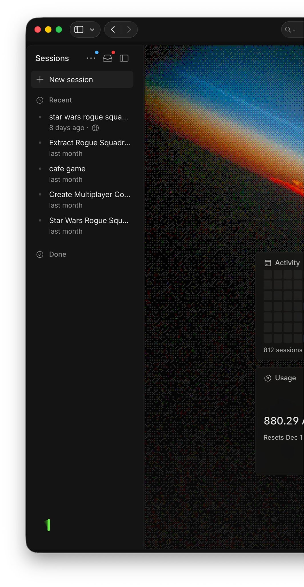

- **Ref. 02 (Sessions):** a UI inteira é neutra: fundo `#0f0e0d`, sidebar `#141414`, texto `#dfe1e2` (contraste 14:1). A cor aparece só em três lugares: dois pontinhos de notificação (azul e vermelho), o traço verde de status e o arco-íris em dithering do fundo, feito com **tintas RGB puras** (`#308dc7`, `#fe403f`, `#65ef3a`).
- **Ref. 05 (Kimi):** moldura preta `#000`, ícones brancos. A única cor da UI é o avatar em gradiente magenta. Todo o resto da cor está nas nuvens pixeladas.
- **Ref. 06 (grid de apps):** cartões pretos `#020202`–`#121112`, texto branco. A cor vem só das fotos, dos gradientes e do ASCII dentro dos cards.

> **A fórmula:** UI acromática + uma camada de arte cromática = luxo. A interface parece um instrumento; a arte, uma janela.

### Como montar a escala de cinza

1. **Neutro puro ou tingido?** O cinza puro (croma 0) ao lado de laranja parece azulado: o cinza "puxa" a complementar do vizinho (Albers). Por isso **tinja os neutros** com croma de 0,003 a 0,015 no matiz da marca ou no complementar do acento.
2. **12 passos (modelo Radix):** 1–2 fundos · 3–5 componentes (normal, hover, pressionado) · 6–8 bordas (sutil, interativa, forte/foco) · 9–10 sólidos · 11–12 texto (secundário, principal).
3. **Gere em OKLCH**, variando só o L. Abaixo estão as escalas calculadas, com o contraste de cada passo contra o passo 1:

**Escuro, neutro frio (h 260, C 0,006)**

| Passo | OKLCH | HEX | Contraste com o passo 1 | Uso |
|---|---|---|---|---|
| 1 | `oklch(.145 .006 260)` | `#090a0d` | 1,00 | fundo do app |
| 2 | `oklch(.175 .006 260)` | `#0f1113` | 1,04 | fundo sutil |
| 3 | `oklch(.205 .006 260)` | `#16171a` | 1,10 | componente |
| 4 | `oklch(.235 .006 260)` | `#1c1e21` | 1,19 | hover |
| 5 | `oklch(.265 .006 260)` | `#232528` | 1,29 | pressionado / selecionado |
| 6 | `oklch(.295 .006 260)` | `#2b2d30` | 1,43 | borda sutil |
| 7 | `oklch(.345 .006 260)` | `#37393c` | 1,72 | borda interativa |
| 8 | `oklch(.43 .006 260)` | `#4e5053` | 2,44 | borda forte / foco |
| 9 | `oklch(.56 .006 260)` | `#727578` | **4,25** ⚠️ | sólido; **não use em texto de corpo** |
| 10 | `oklch(.62 .006 260)` | `#84868a` | 5,44 | texto terciário |
| 11 | `oklch(.77 .006 260)` | `#b2b4b8` | 9,55 | texto secundário |
| 12 | `oklch(.95 .006 260)` | `#eceff3` | 17,11 | texto principal |

**Claro, neutro quente "papel" (h 85, C 0,006)**

| Passo | OKLCH | HEX | Contraste com o passo 1 | Uso |
|---|---|---|---|---|
| 1 | `oklch(.99 .006 85)` | `#fefcf7` | 1,00 | fundo |
| 2 | `oklch(.975 .006 85)` | `#f9f6f2` | 1,04 | fundo sutil |
| 3 | `oklch(.95 .006 85)` | `#f0eeea` | 1,12 | componente |
| 6 | `oklch(.89 .006 85)` | `#dcdad6` | 1,35 | borda sutil |
| 8 | `oklch(.78 .006 85)` | `#b9b7b3` | 1,95 | borda forte |
| 9 | `oklch(.56 .006 85)` | `#767471` | 4,52 | texto terciário (mínimo AA) |
| 11 | `oklch(.45 .006 85)` | `#575552` | 7,23 | texto secundário |
| 12 | `oklch(.22 .006 85)` | `#1c1a17` | 16,82 | texto principal |

**Regras da acromacia:**
- **No máximo 1 acento** de marca. As cores semânticas (erro, sucesso) entram dessaturadas e só onde há estado.
- **Hierarquia de texto em 3 níveis:** 12 → 11 → 10. Texto com opacidade (`rgb(255 255 255 / .64)`) só funciona sobre fundo uniforme; sobre imagem use valor sólido.
- **Trocar uma cor por um peso:** onde você usaria azul para destacar, use peso tipográfico, tamanho ou espaço.

---

## 6. Teoria das cores aplicada à tela

### Os axiomas de Albers que mais importam na web `[16]`

1. **Uma cor nunca aparece sozinha.** O laranja fica mais quente sobre azul-meia-noite e mais apagado sobre bege. Teste o acento em **todos** os fundos onde ele vai aparecer.
2. **Complementares vibram na borda.** Laranja × azul (vídeos 1 e 2: cânion e céu, tijolo e céu) é delicioso em imagem e perigoso em texto fino.
3. **A quantidade muda a cor.** 5% de laranja é acento; 50% é tema. Declare a proporção nos tokens.
4. **A temperatura cria profundidade.** O quente avança e o frio recua: laranja na frente, azul atrás.
5. **O gradiente é o caminho, não as duas pontas.** O espaço de interpolação importa tanto quanto as cores.

### Harmonias que aparecem nas suas referências

| Harmonia | Referência | Por que funciona |
|---|---|---|
| **Complementar natural** | vídeo 1 (cânion: ferrugem × céu `#159de3`), vídeo 2 (tijolo × céu) | a natureza dá a proporção certa: o azul ocupa só uns 10% e vibra na borda |
| **Monocromática + branco** | 04 nuvens cobalto, 08 Dodge `#003afd` | um matiz só, quase em croma máximo; o branco faz todo o desenho. Lê como autoridade (lembra o azul Klein) |
| **Análoga de luminância** | 03 halftone (branco → azul → marinho) | é a luminância que trabalha, não o matiz |
| **Duotom** | vídeo 3 (vermelho romano + creme) | 2 tintas = linguagem de impressão e editorial |
| **Céu + terra** | 11 Pluto (azul × verde) | um par natural e calmo; o CTA é **o mesmo matiz do céu, com mais croma** |

### Proporção

Use **70 / 25 / 5** (fundo / neutros / acento) em produto e **60 / 30 / 10** em marca. Refs 07 (Sookti) e 06 (vídeo 3) mostram: 66% preto + 12% laranja, e 64% vermelho + 30% creme.

### O espaço de cor: OKLCH

- **L** = luminosidade perceptual (0–1), **C** = croma, **H** = matiz em graus.
- O HSL mente: `hsl(60 100% 50%)` (amarelo) e `hsl(240 100% 50%)` (azul) têm o "mesmo L", mas um é muito mais claro que o outro. Em OKLCH o mesmo L **parece** igualmente claro.
- O OKLCH também chega no gamut P3 (cores mais vivas em telas modernas), o que hex/rgb/hsl não fazem.

```css
/* gerar variações da marca sem sair do matiz */
--brand: oklch(0.58 0.21 264);
--brand-hover: oklch(from var(--brand) calc(l + 0.06) c h);    /* relative color syntax */
--brand-soft:  color-mix(in oklch, var(--brand) 14%, var(--bg));
/* gradiente sem o cinza "barrento" no meio */
background: linear-gradient(135deg in oklch, #0b1638, #ff6a1a);
```

### Contraste

- **Regra que vale hoje: WCAG 2.2 AA.** 4,5:1 para texto normal; 3:1 para texto grande (≥ 24 px, ou ≥ 18,66 px em negrito) e para componentes de UI.
- **APCA** (candidato do WCAG 3) avalia melhor o modo escuro: Lc ≈ 60 para corpo, ≈ 75 preferível, ≈ 45 para títulos. **Mas ainda não é norma.** Uma revisão de abril de 2026 diz que o algoritmo do WCAG 3 continua indefinido. Use como segunda opinião.
- **Sobre gradiente, vídeo ou imagem:** meça no **pior ponto, no pior quadro**.

**Contrastes medidos nas suas paletas:**

| Par | Contraste | Veredito |
|---|---|---|
| creme `#ffe3dd` sobre vermelho romano `#8b1a15` | 7,66:1 | AAA |
| branco sobre cobalto Dodge `#003afd` | 6,95:1 | AA |
| branco sobre céu Pluto `#27429b` | 8,98:1 | AAA |
| laranja Sookti `#f17020` sobre `#090909` | 6,71:1 | AA |
| violeta `#4c45e1` sobre lavanda `#fcfafd` | 6,23:1 | AA |
| branco sobre o CTA da Pluto `#1a7ff2` | **3,92:1** | ⚠️ só passa como texto grande/negrito; em 16 px normal reprova |

---

## 7. Temas escuros e claros do jeito certo

### Tema escuro: 10 regras

1. **Fundo de leitura não é `#000` puro.** Use `#0a0a0a`–`#121212` (o Material recomenda `#121212`). O preto puro fica para a **moldura ou "hardware"** (moniscalling, ref. 05) e para telas OLED. Ali o `#000` é proposital e lê como objeto físico.
2. **Elevação = mais claro, não sombra.** Quanto mais alta a superfície, mais clara ela fica (sobreposição clara no Material; *base* × *elevated* no HIG da Apple).
3. **Contorno no lugar de sombra:** `1px` de `rgb(255 255 255 / .06–.10)` mais um **realce de luz em cima** (`inset 0 1px 0 rgb(255 255 255 / .06)`). A sombra quase não aparece no escuro; a luz de cima sim.
4. **Dessature os acentos.** Cores saturadas no escuro vibram e reprovam no contraste. Use acentos mais claros e menos croma (`oklch(.72 .14 h)` em vez de `oklch(.58 .21 h)`).
5. **Texto não é `#fff`.** Use 92–95% de L (`#eceff3`, `#f5f5f7`). O branco puro em área grande cria halo.
6. **Texto claro em fundo escuro parece mais grosso.** Baixe um peso (500 → 400) ou abra +0,01 em de tracking em textos pequenos.
7. **Imagens:** escureça um pouco (`filter: brightness(.92)`) ou aplique um véu; logos de clientes viram monocromáticos com 50–60% de opacidade.
8. **Escuro não é o claro invertido.** Cada tema tem a sua escala (as duas tabelas da seção 5 são diferentes de propósito).
9. **Respeite as preferências do sistema:** `prefers-contrast: more` (bordas mais fortes) e "reduzir transparência" (vidro vira sólido).
10. **Teste os dois temas em todas as telas**, inclusive estados vazios e de erro.

### Tema claro: 7 regras

1. **Fundo off-white** (`#fefcf7`, papel `#f6f4ef`, lavanda `#fcfafd` da ref. 10), com **cards em branco puro** por cima. No claro, elevação = mais branco + sombra.
2. **Texto não é `#000`:** use `#1c1a17` ou `#1d1d1f`.
3. **Sombra em camadas e tingida:** `0 1px 2px rgb(16 24 40 / .06), 0 12px 32px -12px rgb(16 24 40 / .18)`.
4. **Bordas com 6–10% de preto.** Ou nenhuma borda, só a diferença de fundo.
5. **O acento pode ser saturado** contra o branco, mas confira o texto **sobre** o acento (o caso da Pluto).
6. **"Claro" não precisa ser branco:** céu cobalto (04), azul Dodge (08) e lavanda (10) são temas claros cromáticos. A tendência é ter uma cor de fundo como identidade.
7. **Grão sutil** (6–8%) no fundo claro deixa o papel com "matéria".

### Arquitetura de tokens

```
primitivos   →  semânticos            →  componentes
gray-1..12      --bg, --surface-1..3      --card-bg = var(--surface-1)
blue-1..12      --border, --hairline      --btn-bg  = var(--accent)
                --text-1..3, --accent     --focus   = var(--accent)
                --on-accent, --focus
```

**Gerar o tema a partir de poucas variáveis** (como o Linear: base, acento, contraste) evita ter 300 cores soltas. Código completo na receita 17.1.

### Trocar de tema sem "piscar"

- Um script **inline no `<head>`** lê a preferência antes da primeira pintura.
- `color-scheme` + `light-dark()`: um único token serve aos dois temas.
- Transição elegante: **View Transition com um círculo** que se abre a partir do botão (receita 17.12). Desde outubro de 2025 a view transition dentro do mesmo documento é Baseline (Firefox 144).

---

## 8. Jogos de cores: 10 paletas medidas

Cores tiradas **dos pixels** das suas referências (média dos pontos do dithering = a cor que o olho percebe, mais amostras pontuais dos acentos). A porcentagem é a área aproximada.

### 8.1 Cobalto e nuvem (refs 04 + 08)
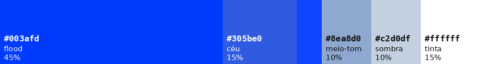
`#003afd` flood · `#305be0` céu · `#0e45ff` linha de grade · `#8ea8d0` meio-tom · `#c2d0df` sombra da nuvem · `#ffffff` tinta.
**Por que funciona:** um matiz só, quase no croma máximo, e o branco desenha tudo. A grade é **um passo mais claro** que o fundo (Dodge), não cinza.
**Use em:** marca B2B que quer parecer confiável e ousada ao mesmo tempo. Branco sobre `#003afd` dá 6,95:1.

### 8.2 Céu e colina (ref. 11, Pluto)
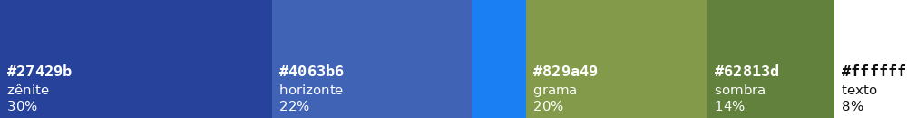
`#27429b` zênite · `#4063b6` horizonte · `#1a7ff2` CTA · `#829a49` grama · `#62813d` sombra · `#ffffff` texto.
**Por que funciona:** o céu escurece para cima (perspectiva atmosférica real), e o texto fica na zona mais calma. O CTA tem **o mesmo matiz do céu, mais claro e mais croma**: destaca sem trazer cor nova.

### 8.3 Sálvia e creme (ref. 05, Kimi)
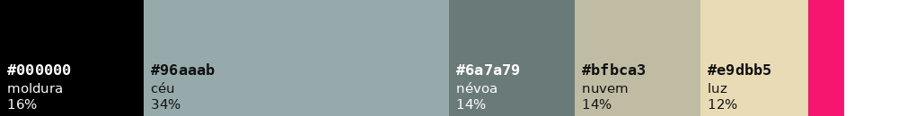
`#000000` moldura · `#96aaab` céu · `#6a7a79` névoa · `#bfbca3` nuvem · `#e9dbb5` luz · `#f61670` acento · `#ffffff` ícone.
**Por que funciona:** um céu dessaturado e nuvens bege, com cara de foto analógica, dentro de uma moldura de preto absoluto. O contraste vem do preto, não da saturação.

### 8.4 Cânion (vídeo 1)
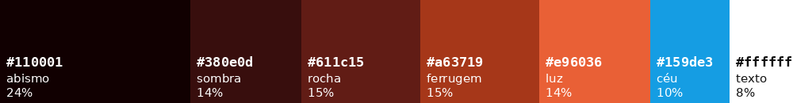
`#110001` abismo · `#380e0d` sombra · `#611c15` rocha · `#a63719` ferrugem · `#e96036` luz · `#159de3` céu · `#ffffff` texto.
**Por que funciona:** uma complementar natural em proporção natural: 90% quente e 10% de azul. O azul vibra na borda da rocha (Albers).

### 8.5 Tijolo e céu (vídeo 2)
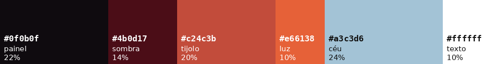
`#0f0b0f` painel · `#4b0d17` sombra · `#c24c3b` tijolo · `#e66138` luz · `#a3c3d6` céu · `#ffffff` texto.
**Por que funciona:** a mesma família do cânion, com o painel do menu quase preto e **levemente vinho**. O painel herda o tom da foto em vez de ser cinza.

### 8.6 Vermelho romano (vídeo 3)
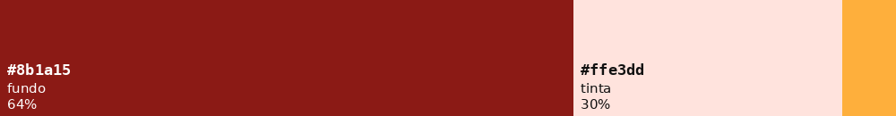
`#8b1a15` fundo · `#ffe3dd` tinta · `#feaf3c` rótulo.
**Por que funciona:** duotom de impressão (2 tintas) aplicado a uma estátua clássica = "pensamento que dura". O laranja só aparece nos quadradinhos dos rótulos, uns 6%.

### 8.7 Meia-noite e laranja (ref. 07, Sookti)
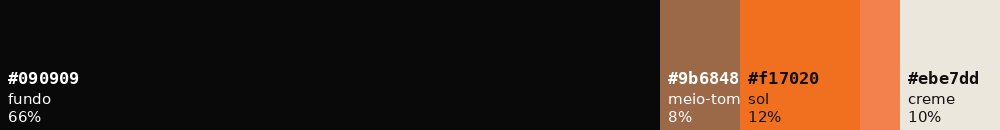
`#090909` fundo · `#9b6848` meio-tom · `#f17020` sol · `#f2814d` brilho · `#ebe7dd` creme.
**Por que funciona:** é exatamente o "midnight + orange" do playbook *atmospheric-gradient*: preto quente, um sol laranja e o creme como luz. O tagline em mono branco reforça o lado técnico.

### 8.8 Ultravioleta (ref. 10, breakout)
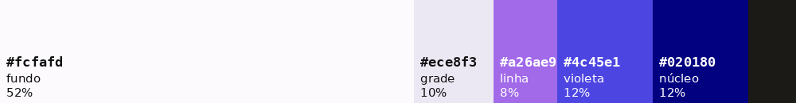
`#fcfafd` fundo · `#ece8f3` grade · `#a26ae9` linha · `#4c45e1` violeta · `#020180` núcleo · `#1c1a17` texto.
**Por que funciona:** tema claro que não é branco (lavanda quase imperceptível). O violeta vai do claro ao "núcleo" azul-marinho: monocromático com profundidade.

### 8.9 Neon no escuro (ref. 02, Sessions)
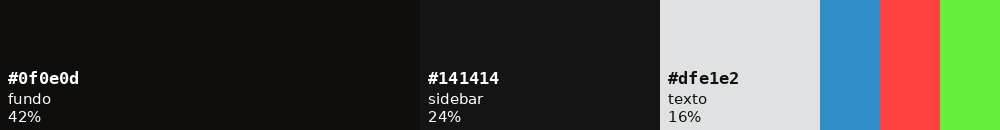
`#0f0e0d` fundo · `#141414` sidebar · `#dfe1e2` texto · tintas `#308dc7` / `#fe403f` / `#65ef3a`.
**Por que funciona:** RGB primário em dithering é a cor "nativa da tela" (subpixel), e a UI fica 100% acromática.

### 8.10 Abissal (ref. 03, halftone)
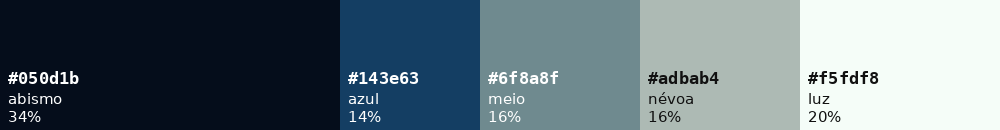
`#050d1b` abismo · `#143e63` azul · `#6f8a8f` meio · `#adbab4` névoa · `#f5fdf8` luz.
**Por que funciona:** uma faixa de luz diagonal atravessa o escuro, como uma crista de onda. É a base dos "gradientes com highlight" da seção 10.

---

## 9. Dithering, halftone, pixel e ASCII

### Por que agora

1. **Contra o liso da IA:** os relatórios de 2026 falam em *imperfect realness* (Vistaprint), *tactility is a credibility marker* (Kota) e criticam o *"branding by autocomplete"* (Fast Company). A textura prova que houve uma decisão.
2. **Unifica qualquer imagem:** um tratamento de 2 a 4 tintas transforma fotos diferentes (até geradas por IA) num **sistema visual** coerente com a marca. É o maior ganho prático.
3. **Nostalgia de computador:** 1-bit, Mac clássico, Obra Dinn, CRT. Lê como "feito por quem entende de tela".
4. **Esconde o *banding*** dos gradientes em telas de 8 bits.

### Taxonomia (com as suas referências)

| Técnica | Como reconhecer | Referência |
|---|---|---|
| **Ordenado (Bayer 2×2 / 4×4 / 8×8)** | trama regular em cruz ou xadrez | 04 nuvens (trama diagonal), vídeo 3 (busto) |
| **Halftone AM** | pontos redondos que **mudam de tamanho** | 03 (gradiente azul), Paper *HalftoneDots* |
| **Difusão de erro (Floyd–Steinberg, Atkinson)** | grão orgânico, sem padrão | 08 (figuras rabiscadas) |
| **Ruído RGB / blue noise** | pontos coloridos aleatórios e uniformes | 02 (arco-íris) |
| **Pixelização + limiar** | blocos grandes com recorte "comido" | 05 (nuvens), 10 (breakout) |
| **ASCII por luminância** | glifos (números) no lugar dos pixels | 06 (frutas com dígitos) |
| **ASCII em faixas ("código de barras")** | tiras horizontais coloridas com glifos dentro | 07 (cavalo Sookti) |
| **Híbrido: dither ou ASCII sobre blur** | glifos nítidos sobre bokeh desfocado | 06 (card "Dinner") |

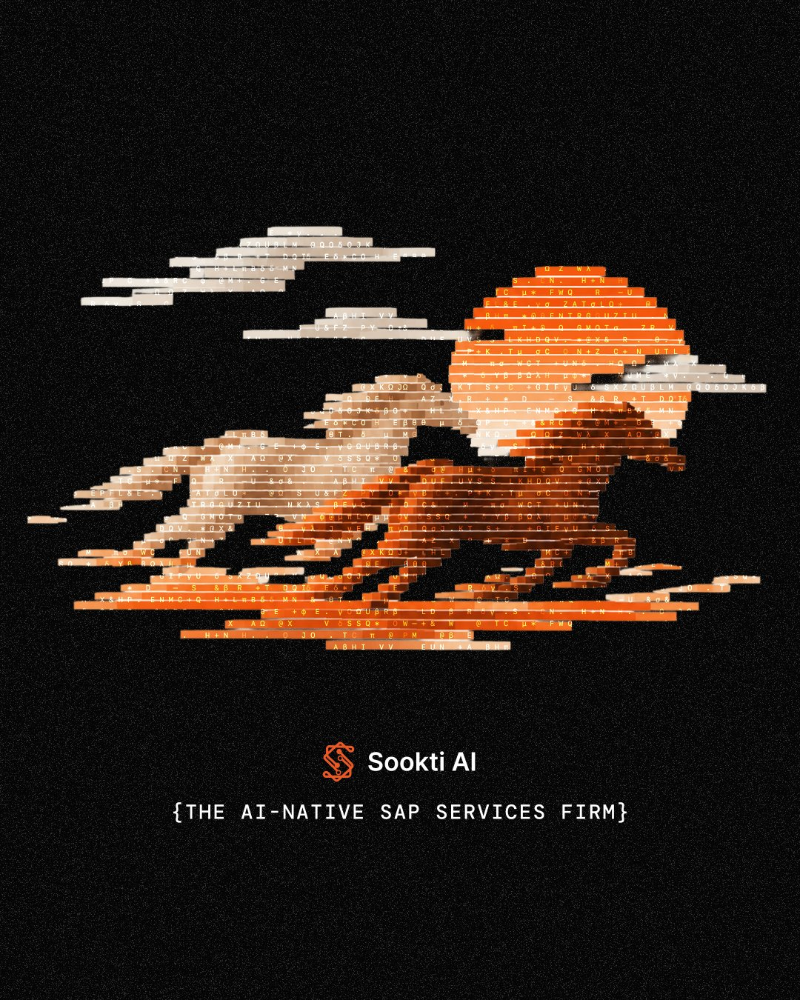
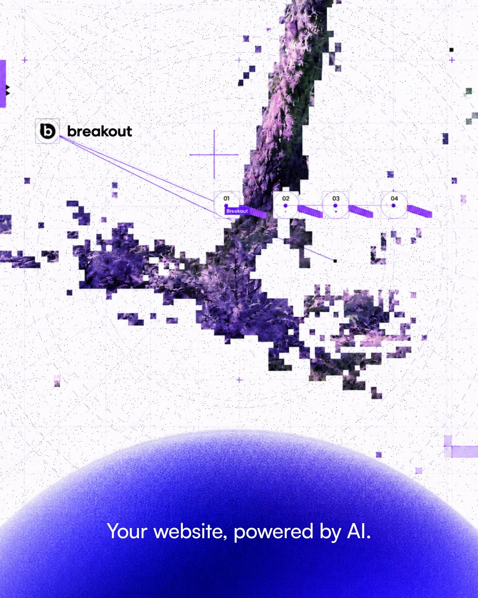

### Os algoritmos em 1 minuto (fonte: Surma, *Ditherpunk*)

- **Limiar:** pixel claro vira tinta B, escuro vira tinta A. Sozinho, fica duro.
- **Ruído branco:** some ruído antes do limiar. Funciona, mas forma grumos.
- **Bayer (ordenado):** uma matriz de limiares repetida. É paralelo, perfeito para GPU, e cria a trama "de computador". Tende a clarear as sombras (viés).
- **Blue noise:** limiares sem frequência baixa: grão bonito e uniforme. Gerar é lento; use uma **textura pronta** (64×64 ou 128×128) em loop.
- **Difusão de erro:** o erro de cada pixel vai para os vizinhos (Floyd–Steinberg 7/16·3/16·5/16·1/16; Atkinson difunde só 6/8 e por isso dá mais contraste). É sequencial: **não roda em shader**, faça na CPU ou offline.
- **⚠️ Gamma:** o canvas e as imagens estão em sRGB. Fazer dithering em sRGB deixa os gradientes claros demais. Converta para linear antes (≈ `pow(c, 2.2)`).

### Rotas de implementação

| Rota | Quando | Observações |
|---|---|---|
| **Paper Shaders** (`@paper-design/shaders-react`) | quer pronto e leve | `Dithering` (formas simplex, warp, dots, wave, ripple, swirl, sphere; tipos `random`, `2x2`, `4x4`, `8x8`; `pxSize` 1–20; `colorBack`/`colorFront`), *Image Dithering*, *Halftone Dots*, *Halftone CMYK*. **Pré-1.0: fixe a versão exata.** Licença **PolyForm Shield** (uso comercial ok, mas não pode competir com o Paper) |
| **Pós-processamento Three.js** (`postprocessing` + `Effect` próprio) | cena 3D dithered (vídeo 3) | ver Maxime Heckel e Codrops *Building a Real-Time Dithering Shader* (2025) |
| **Shader próprio** (receita 17.8) | controle total, 1 passe | Bayer 8×8, 2 tintas, uniform de limiar para dissolver |
| **CSS puro (halftone)** | imagem estática, zero JS | `radial-gradient` + `multiply` + `contrast()` (receita 17.7) |
| **Offline (Python/Pillow, skill pixel-art-studio)** | assets fixos, difusão de erro | gere PNG/WebP dithered de verdade e sirva como imagem |
| **ASCII: `ascii.rest`** | ASCII animado de logo/foto | a página **ascii.rest/make** converte SVG/PNG/JPG/WebP/GIF em ASCII animado **no navegador** (*"The file is never uploaded"*). Modos *logo*, *shade* (`.` → `@`) e *motion* (*glint*/*scan*). `npm install ascii.rest` → `mount(el, piece, options)`. Respeita reduced motion (segura o 1º quadro, a menos que `motion: true`). Licença MIT |
| **ASCII: outras** | — | `lettercrap` (máscara de imagem vira ASCII dinâmico), `p5.asciify` (p5.js/WebGL em tempo real), `AsciiEffect` do Three.js, `glsl-ascii-filter`, Codrops *Creating an ASCII Shader Using OGL* (2024), *Beyond the Luminance Ramp* (renderer que escolhe entre 95 glifos pelo formato), *Efecto* (jan/2026, ASCII + dithering em WebGL) |

> **Sobre "make-ascii":** não achei nenhuma biblioteca com esse nome exato. O mais próximo é a página **ascii.rest/make** (acima), que faz exatamente "transformar em ASCII". Se você viu o nome em outro lugar, me mande o link.

### Como recriar o ASCII da Sookti (faixas)

1. Reduza a imagem para uma grade de linhas (ex.: 12 px de altura).
2. Quantize cada linha em 4–6 cores e agrupe os trechos de **cor igual**.
3. Desenhe cada trecho como um retângulo sólido da cor e escreva dentro glifos aleatórios (`ΑβΘ&%#@`) num tom **um passo mais claro**, em fonte mono.
4. Fundo preto com grão; sol e cavalo em laranja/creme. A leitura é de "dado se tornando imagem".

### Regras de uso (o que as referências ensinam)

1. **A UI nunca leva dithering.** Só a camada de arte (02, 05). Texto e controles ficam nítidos por cima, sobre painel **sólido** (sidebar preta).
2. **Alinhe ao pixel do aparelho:** `pxSize` inteiro × `devicePixelRatio`. Com DPR fracionado (1,25; 1,5) aparecem moiré e artefatos. Use `image-rendering: pixelated` em PNGs.
3. **De 2 a 4 tintas, tiradas da paleta.** Mais que isso volta a parecer foto ruim.
4. **Anime devagar ou só na interação** (o vídeo 3 reage ao cursor). Fora isso, deixe parado.
5. **Tenha uma alternativa estática** (PNG ou WebP dithered) para reduced motion, sem WebGL e para aparelhos fracos.
6. **Orçamento:** renderize a 0,5–0,75× do DPR, pause fora da tela (`IntersectionObserver`) e com a aba oculta.

---

## 10. Gradientes vivos: blur, highlight e ondas

### A anatomia do gradiente "delicioso"

O que dá a sensação de onda **não é o gradiente, é a crista de luz** passando por cima dele. A ref. 03 mostra isso: uma faixa clara diagonal atravessando o marinho.

```
camada 5  grão 8–12% (overlay)               ← materialidade, mata o banding
camada 4  CRISTA: faixa estreita e muito clara, ← o "highlight" que vira onda
          desfocada, em screen, que se move
camada 3  blur 60–120px                       ← funde tudo
camada 2  2–4 manchas de cor (radial)          ← a massa de cor
camada 1  fundo escuro de base
```

**Receita (CSS):** 17.10. **Shader:** fBm com *domain warping* (`fbm(p + fbm(p))`) dá o líquido do monopo; o gradiente da Stripe (minigl, engenharia reversa de Kevin Hufnagl, republicada pelo Bram.us) é a referência clássica de malha em onda. Atalho: Paper `MeshGradient` / `GrainGradient` ou `~/.parede-da-ia/library/gradients/mesh-field.glsl`.

### Os 12 tipos (blur library, `~/.parede-da-ia/library/gradients/blur-library.css`)

Irregular (orgânico) · Radial Ramp (pôr do sol, foco) · Blurred (premium, atrás de UI) · Edgy (gráfico) · Landscape (horizonte) · Multicolor (festivo) · Retro (espectro) · Duotone (corporativo) · Tricolor · Volume Mesh (orbe) · Banding (8-bit, editorial) · Gradient/Image (foto tingida).

### Regras

1. **Interpole em OKLCH ou OKLab** (`linear-gradient(in oklch, …)`). Em RGB, azul × laranja vira cinza no meio.
2. **Sempre com grão.**
3. **O campo é atmosfera, não figura:** ele vaza da moldura e nunca briga com o texto.
4. **Animado = lento:** deriva de 15–25 s; em shader, velocidade 0,1–0,25; reduced motion congela.
5. **Brilho de borda estilo Apple Intelligence:** um `conic-gradient` girando, mascarado na borda e desfocado. Use para "IA pensando", não como enfeite fixo.
6. **Contraste do texto no pior quadro.** Em shader, renderize a 0,5–0,75× do DPR.

---

## 11. Moniscalling: a escala de monitor

> **Definição (o seu termo):** *moni* (monitor) + *scaling* (escala). É tratar a interface como **uma tela física dentro da tela**: uma moldura fina e de espessura **constante**, com um lado engrossado como **trilho** (sidebar), e um **poço** de conteúdo com cantos arredondados cujo raio **vem da moldura fina, não do trilho**. Resultado: a curva perto da sidebar parece uma extensão líquida da moldura, e a borda fina **não cresce** junto com a sidebar.

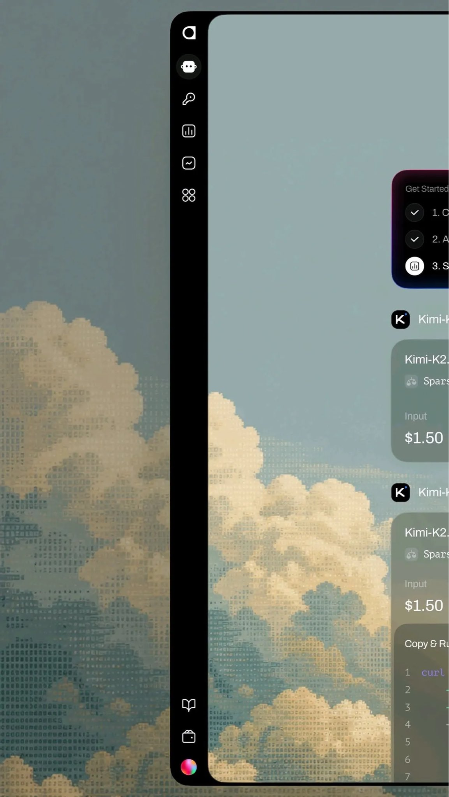

### Medição da sua referência (05), em pixels do print

| Medida | Valor | Relação |
|---|---|---|
| Bezel fino (topo, direita, base) | **6–7 px** | `t` |
| Trilho (sidebar) | **93 px** | ≈ 15·t |
| Raio externo da moldura | **≈ 48 px** | ≈ 8·t |
| Raio do poço (**inclusive no canto do lado do trilho**) | **≈ 42 px** | **= R − t** |

A medição confirmou a hipótese: o canto do poço junto ao trilho usa **o mesmo** `r = R − t` dos outros cantos.
- Se o raio viesse do trilho (`R − 93`), daria negativo e o canto ficaria **quadrado**.
- Se fosse igual ao externo (`r = R`), a folga **engordaria** nos cantos.
- Manter `r` constante é o que dá a sensação de "a curva escorre do bezel".

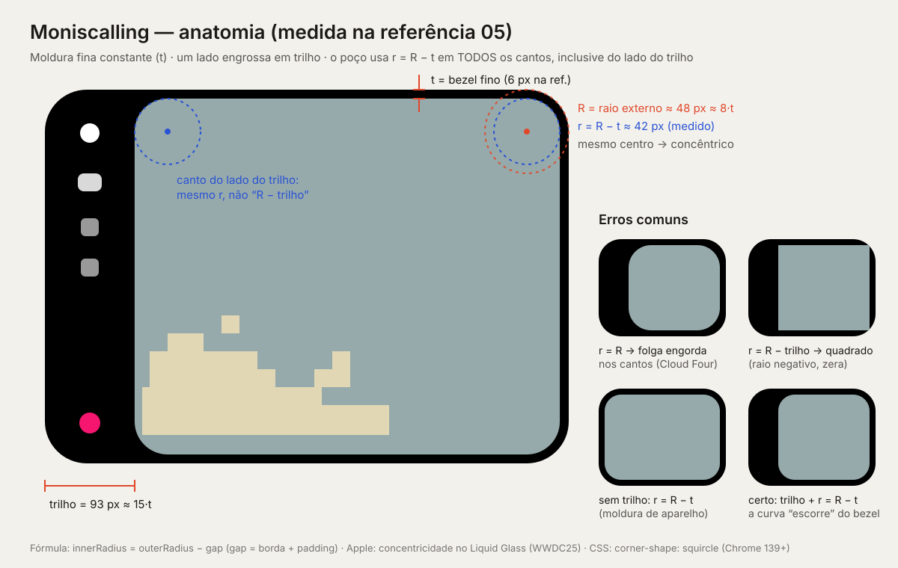

### Por que é delicioso

1. **Metáfora de hardware:** a borda de um iPhone ou de um monitor tem espessura física constante. A moldura fina e fixa faz o software parecer **objeto**.
2. **Concentricidade:** é o princípio do Liquid Glass (WWDC25). Formas que compartilham o centro do canto parecem "encaixadas", não empilhadas.
3. **Um material só:** trilho e moldura têm a mesma cor e são lidos como uma peça; o conteúdo está **dentro** dela.
4. **Moldura preta = tela acesa:** qualquer conteúdo dentro do poço (o céu pixelado) parece emitir luz.

### A matemática

- **Cloud Four:** `outerRadius − gap = innerRadius`, onde `gap = espessura da borda + padding`. Use `max(0px, …)` para não ficar negativo.
- **Apple:** `ConcentricRectangle` / `containerShape(_:)` fazem essa conta. A cápsula tem raio = altura/2.
- **Mozilla (redesign Nova do Firefox):** registrou num bug que cantos concêntricos com o **mesmo** raio "não ficam certos". Os internos precisam de raio menor.
- **A "escala de monitor":** o bezel `t` fica **constante em px** entre telas (hardware não escala) e só o conteúdo escala. `R` segue `t` (≈ 6–8·t), limitado a cerca de 1/4 do menor lado. No celular em tela cheia, `t` → 0 e `R` → 0 (ou o raio do aparelho).

### Implementação (CSS)

```html
<div class="shell">
  <nav class="rail">…ícones…</nav>
  <main class="well">…conteúdo…</main>
</div>
```

```css
.shell {
  --t: 8px;                                   /* bezel fino: constante, não escala */
  --rail: 72px;                               /* trilho: pode crescer à vontade */
  --R: 32px;                                  /* raio externo da moldura */
  --r: max(0px, calc(var(--R) - var(--t)));   /* raio do poço: SEMPRE do bezel fino */

  display: grid;
  grid-template-columns: var(--rail) 1fr;
  padding: var(--t) var(--t) var(--t) 0;      /* lado do trilho sem padding: o trilho É o bezel */
  height: 100dvh;
  border-radius: var(--R);
  background: #000;                           /* um material: moldura = trilho */
}
.well {
  border-radius: var(--r);
  overflow: clip;
  background: var(--surface-1);
  box-shadow: inset 0 0 0 1px rgb(255 255 255 / .06);  /* hairline interno, não sombra */
}
@supports (corner-shape: squircle) {
  .shell, .well { corner-shape: squircle; }   /* curvatura contínua, estilo Apple */
}
@media (max-width: 640px) {
  .shell { --t: 0px; --R: 0px; grid-template-columns: 1fr; }  /* no celular o aparelho É a moldura */
  .rail  { position: fixed; inset: auto 0 0 0; }               /* trilho vira dock */
}
```

> `corner-shape: squircle` / `superellipse()` está no **Chrome 139+**, no Firefox **163** e no Safari só no Technology Preview (dados do caniuse em 2026). Use como melhoria progressiva. Com squircle o canto "fecha" mais; a conta concêntrica continua valendo e você pode aumentar R uns 10–20% para compensar.

### Variações

1. **Shell de app** (refs 02 e 05): trilho e poço.
2. **Página inteira:** `body` preto e o site inteiro dentro de um poço com 8–12 px de margem. A navegação mora no **bezel de cima engrossado** (um trilho horizontal).
3. **Hero que vira moldura no scroll:** começa em tela cheia (t=0, R=0) e, ao rolar, encolhe para t=12, R=28, revelando a moldura. É a sua "vinhetinha" (receita 17.3).
4. **Card dentro de painel:** `r_card = r_painel − padding_do_painel`, recursivamente.
5. **Mockup de aparelho dentro do card** (ref. 06): o raio do iPhone é concêntrico com o do card.

### Erros

- O mesmo raio dentro e fora (a folga engorda nos cantos).
- Raio interno calculado pelo trilho (canto quadrado).
- Hairline com mais de 1 px (fica pesado).
- Bezel em `vw` (perde a sensação de hardware).
- Sombra no poço dentro da moldura preta (desnecessária; use o hairline interno).
- Misturar squircle e canto circular no mesmo aninhamento.

---

## 12. Landing pages com identidade e autoridade

### A fórmula atual da hero (o que as referências e a pesquisa mostram)

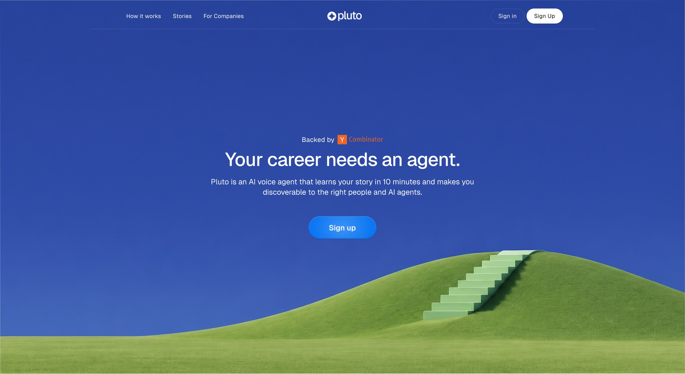

| Elemento | Regra | No exemplo da Pluto |
|---|---|---|
| **Fundo** | 100svh, imagem gigante (paisagem, render, foto ou arte em dithering) | céu + colina verde em render, ocupando a tela toda |
| **Imagem-metáfora** | a imagem **diz** a promessa sem palavras | uma escada subindo a colina = carreira em ascensão |
| **Selo de autoridade** | uma linha acima do título | "Backed by **Y Combinator**" (o único laranja da tela) |
| **Título** | ≤ 8 palavras, uma promessa | "Your career needs an agent." (5 palavras) |
| **Subtítulo** | ≤ 2 linhas, concreto, com número | "learns your story in **10 minutes**" |
| **CTA** | 1 primário (+1 fantasma no nav) | pílula azul com brilho interno; no nav, *Sign in* fantasma + *Sign Up* em pílula branca |
| **Navegação** | 3–4 links, logo no centro ou à esquerda | links à esquerda, logo no centro, ações à direita, hairline embaixo |
| **Espaço negativo** | o texto fica na zona **mais calma** da imagem | os 60% de cima são céu liso, então o contraste é garantido |

### Paisagens e pessoas na hero: por que e como

- **Paisagem:** calma, aspiração, "fora da tela", natureza contra o cansaço digital. Muitas vezes é render 3D ou imagem gerada, com nostalgia do papel de parede *Bliss* do Windows XP.
  - **Risco:** virar stock genérico.
  - **Antídoto:** dar à paisagem **um objeto narrativo** (escada, porta, uma figura) e **um tratamento de marca** (paleta, dither, grão).
- **Pessoas:** rosto real = autoridade e calor (ref. 06 "SPOTTED", o perfil "Imani Okafor"). O Site of the Year 2025 da Awwwards (site do Lando Norris, pela OFF+BRAND) põe **a pessoa no centro**, com manchas reativas ao cursor sobre a foto.
- **Arquitetura e natureza com diagonais fortes** (vídeos 1 e 2): as linhas da imagem **levam o olho** até o menu e o CTA.
- **Os relatórios de 2026** dizem duas coisas: a hero com WebGL pesado está ficando "cara" demais (LCP), e muitas marcas trocam ou complementam a imagem com tipografia enorme. Imagem leve + tipo forte é a aposta segura.

### Identidade: o sistema mínimo

- **1 display + 1 texto + 1 mono.** A mono vai nos metadados, rótulos e preços. É o "documento técnico" que passa seriedade: `{THE AI-NATIVE SAP SERVICES FIRM}` (Sookti) e os rótulos com quadradinho laranja do vídeo 3.
- **1 campo de cor + 1 acento.**
- **1 tratamento de imagem** aplicado a **tudo** (ex.: dither de 2 tintas).
- **1 assinatura de movimento** (ex.: expo-out com 900 ms para revelar e 200 ms para responder).
- **1 linguagem de forma** (raios do moniscalling, cápsulas).

### Sinais de autoridade (checklist)

- [ ] selo de investidor, prêmio ou cliente acima do título
- [ ] faixa de logos monocromáticos com 40–60% de opacidade
- [ ] número com unidade ("+38%", "10 minutos", "812 sessions")
- [ ] rostos reais (fundadores, clientes)
- [ ] **o produto real na tela** (screenshot dentro de uma moldura moniscalling), não blobs abstratos
- [ ] citações com nome, cargo e foto
- [ ] rótulos técnicos em mono, versão, changelog
- [ ] título que **define categoria**: "AI Control Plane For Enterprise Applications" (Dodge)

### Copy (StoryBrand `[23]`)

O cliente é o herói; a marca é o guia. Sequência: **problema → guia → plano → CTA → o que acontece se não agir → sucesso**. Modelos de título:
- **"X precisa de Y."** → *Your career needs an agent.*
- **3 palavras e um conceito** → *Thought that lasts.* / *Reason to endure.*
- **Definição de categoria** → *AI Control Plane For Enterprise Applications.*
- **Benefício com tempo** → *Your website, powered by AI.*

### Estrutura depois da hero (padrão das landings de ponta em 2025–26)

1. Faixa de prova (logos e números)
2. **Revelação do produto:** UI grande dentro de uma moldura moniscalling, entrando pela transição da hero
3. 3 benefícios contados como história (seções com imagem, não 3 cards)
4. Demo, vídeo ou interação ao vivo
5. Depoimentos com rosto
6. Preço ou CTA final **repetindo a imagem da hero** (amarra o início e o fim; *peak-end rule* `[20]`)

### Performance da hero

Imagem LCP ≤ 200 KB em AVIF/WebP com `fetchpriority="high"`; vídeo com `poster` e `preload="metadata"`; WebGL e shaders **depois** do load (em `requestIdleCallback`); campo de shader a 0,5–0,75× do DPR.

### Onde garimpar referências atuais

- **Awwwards** (vencedores do Annual Awards 2025, segundo a página de vencedores):
  - *Site of the Year:* **Lando Norris** (OFF+BRAND); também venceu o *Users' Choice*
  - *Developer Site of the Year:* **Messenger** (abeto, Three.js)
  - *E-commerce of the Year:* **Scout Motors**
  - *Agency of the Year:* **Immersive Garden**
  - *Studio of the Year:* **Malvah**
  - *Independent of the Year:* **Louis Paquet**
  - Algumas páginas de listagem também mostram "Women At Work" (Trione) com selo SOTY 2025; confira na fonte.
- **Codrops** (tympanus.net): tutoriais e as colunas de inspiração.
- **Galerias:** Godly, Land-book, Lapa Ninja, SiteInspire, Minimal Gallery, One Page Love, SaaS Landing Page, Refero, Mobbin (apps), Cosmos e Savee (moodboards).
- **Ferramentas com shader:** Paper (paper.design), Shader Gradient.

---

## 13. A hero e a "vinhetinha" de transição

A passagem da hero para o site é o **primeiro gesto** da página. Catálogo:

| # | Técnica | Sensação | Custo | Receita |
|---|---|---|---|---|
| 1 | **Encolher em moldura (moniscalling):** a hero em tela cheia vira um card com moldura ao rolar | "a tela vira objeto" | baixo (`clip-path` + `scale`) | 17.3 |
| 2 | **Cortina:** hero `sticky` e a próxima seção sobe **por cima**, com cantos de cima arredondados, enquanto a hero escurece | editorial, elegante | muito baixo | 17.4 |
| 3 | **Dissolver para a página:** máscara de gradiente no pé da hero até a cor do fundo | invisível, contínuo | zero | `mask-image: linear-gradient(#000 70%, transparent)` |
| 4 | **Dissolver em dither:** anima o limiar de Bayer de 0 → 1 e a imagem se desfaz em pixels | assinatura de marca "dithered" | médio (shader) | 17.8 (`uThreshold`) |
| 5 | **Máscara que se abre:** `clip-path: circle()` ou `inset()` cresce de um ponto (o CTA) | revelação | baixo | — |
| 6 | **Zoom através:** o scroll aproxima uma janela ou porta da hero e entra na próxima cena | imersivo | médio | — |
| 7 | **Troca de campo de cor:** o fundo do `body` interpola entre seções | narrativo | baixo | ScrollTrigger `onEnter` |
| 8 | **Título sai, imagem fica:** linhas do título sobem com máscara enquanto a imagem tem parallax mais lento | profundidade | baixo | SplitText `mask: "lines"` |

**Regras:**
1. **Uma** transição por fronteira de seção.
2. Animação presa ao scroll (*scrub*) usa `ease: "none"`: é o único lugar onde linear é correto `[12]`.
3. Nada de *scroll-jacking*.
4. Anime só `transform`, `opacity` e `clip-path`. **Não** anime `filter: blur()` em camadas grandes.
5. Com reduced motion: só um crossfade, ou nada.

---

## 14. Animação com intenção: os princípios

### Para que serve um movimento (Val Head `[13]`)

**Orientar** (de onde veio, para onde foi) · **dar retorno** · **mostrar relação e continuidade** · **personalidade** (pouca). Se não serve a nenhum desses quatro, corte.

### Os 12 princípios da Disney traduzidos (e onde eles aparecem nos seus vídeos)

| # | Princípio | Na interface | Visto em |
|---|---|---|---|
| 1 | Comprimir e esticar | botão afunda (`scale .97`) no clique | vídeo 2: "Menu" fica cinza e afunda antes de abrir |
| 2 | Antecipação | um micro-recuo antes do salto | vídeo 2: o estado de "apertado" vem antes da expansão |
| 3 | Encenação (*staging*) | um foco por vez; o resto apaga | vídeo 2: o hover em "Explore" apaga os outros links |
| 4 | Pose a pose × direto | timeline para coreografia; física para cursor e partículas | vídeo 3: o busto segue o cursor (direto) |
| 5 | Continuidade e sobreposição | os filhos terminam depois do pai | vídeo 2: o painel abre e **depois** os links entram em cascata |
| 6 | Aceleração e desaceleração | ease-out na entrada; nunca linear em objeto | todos |
| 7 | Arcos | trajetórias curvas parecem naturais | cursor magnético, partículas |
| 8 | Ação secundária | o grão se mexe de leve enquanto o título entra | — |
| 9 | Timing | leve 150–250 ms · médio 300–500 · cinematográfico 700–1200 | vídeo 1: morph de ~250–300 ms |
| 10 | Exagero | só no clímax | — |
| 11 | Desenho sólido | luz e volume coerentes | vídeo 3: dither respeita o volume do busto |
| 12 | Apelo | uma assinatura de movimento reconhecível | vídeo 2: o tracinho "– Explore" |

### Interfaces fluidas (Apple, WWDC18)

- **Responda no toque** (`pointerdown`), não ao soltar.
- **Interrompível e redirecionável:** dá para mudar de ideia no meio.
- **Molas em vez de duração fixa** quando há gesto (a velocidade do dedo entra na animação).
- **Momento e elástico** (*rubber band*) nas bordas: o físico vira previsível.

### As regras do Emil Kowalski

- UI: **< 300 ms**, **ease-out** (começa rápido e chega devagar). Evite ease-in em resposta; parece lento.
- As curvas padrão do CSS são fracas: use **curvas próprias**.
- **Nunca anime ações de teclado** nem ações muito frequentes (o Raycast praticamente não anima).
- Anime `transform` e `opacity`. Com a thread principal ocupada, CSS/WAAPI é mais confiável que animação por rAF.
- **Interrompível:** transições CSS se interrompem bem; `@keyframes` não.
- **Reduced motion:** troque o bounce por fade, sem remover o retorno.
- **Revise no dia seguinte:** o ajuste fino é tentativa e erro.

### Rauno Freiberg (detalhes invisíveis)

- Reaproveite **metáforas** (deslizar = virar página).
- Ações leves (mostrar overlay) podem disparar **durante** o gesto; ações pesadas, só no fim.
- Modele propriedades do mundo real, como a **interrupção**.

### Tokens de movimento

```css
:root {
  --dur-1: 120ms;  /* hover, toggle */
  --dur-2: 200ms;  /* tooltip, pressionar */
  --dur-3: 300ms;  /* dropdown, morph pequeno */
  --dur-4: 500ms;  /* painel, modal, pílula→painel */
  --dur-5: 900ms;  /* reveal de seção, hero */

  --ease-out:    cubic-bezier(.22, 1, .36, 1);    /* padrão de UI */
  --ease-expo:   cubic-bezier(.19, 1, .22, 1);    /* reveals cinematográficos */
  --ease-in-out: cubic-bezier(.65, 0, .35, 1);    /* objeto indo de A até B */
  --ease-spring: linear(0, .5 7%, .86 15%, 1.02 24%, 1.04 30%, 1.01 41%, 1 100%); /* mola leve */
}
```

**Coreografia:**
- O pai entra primeiro e os filhos em cascata de 30–60 ms; a seção inteira dura ≤ 1,2 s.
- **A saída é ~30% mais curta** que a entrada e menos dramática.
- Quanto mais uma coisa é usada, menos ela deve se mexer.

**Escolha um dialeto por projeto** (`[13]`):

| Adjetivos | Easings | Durações |
|---|---|---|
| preciso, calmo, confiável | ease-out-quart | 150 / 300 / 600 ms |
| fluido, luxuoso, cinematográfico | expo-out | 200 / 450 / 900–1250 ms |
| elástico, brincalhão | mola, back.out | 180 / 350 / 700 ms |
| seco, editorial, gráfico | `steps()`, power4.inOut, cortes | 120 / 300 / 800 ms |

---

## 15. GSAP, Motion e CSS nativo: boas práticas

### Qual ferramenta usar

| Necessidade | Use |
|---|---|
| hover, foco, estados simples | **transição CSS** (interrompível, grátis) |
| reveal simples ligado ao scroll | **CSS scroll-driven** (`animation-timeline`); Chrome 115+, **Safari 26+**, Firefox só com flag → sempre dentro de `@supports` |
| entrada de popover/dialog | **`@starting-style`** + `transition-behavior: allow-discrete` |
| morph entre estados ou rotas | **View Transitions API** (mesmo documento é Baseline desde out/2025) |
| UI em React com layout que muda | **Motion** (`layout`, `layoutId`, `AnimatePresence`) |
| storytelling de scroll, timelines, texto, SVG | **GSAP** (ScrollTrigger, SplitText, Flip, MorphSVG) |
| campo de cor, dither ao vivo, 3D | **WebGL** (Three.js / OGL / Paper Shaders) |
| scroll suave | **Lenis** (desligado com reduced motion) |

### GSAP: o estado atual

- **100% gratuito desde a 3.13** (29/04/2025, após a compra pela Webflow), **inclusive para uso comercial** e inclusive os plugins que eram pagos (SplitText, MorphSVG etc.). Tudo vem no pacote npm `gsap`. O site já mostra a **v3.15** como atual.
- **SplitText reescrito:** 50% menor e 14 recursos novos:
  - acessibilidade: `aria-label` no elemento e `aria-hidden` nos pedaços
  - `autoSplit` + `onSplit()`: refaz o split quando a fonte carrega ou a largura muda
  - `mask: "lines"`: a máscara de revelação vem pronta
  - `propIndex` (variáveis CSS como `--word: 3`), `smartWrap`, `deepSlice`, modo standalone
  - **mudanças incompatíveis:** saíram `position: "absolute"`, `lineThreshold` e `specialChars` em função
- **Novidade:** animar para uma variável CSS: `gsap.to(el, { color: "var(--accent)" })`.

### GSAP: boas práticas

1. **Registre os plugins uma vez:** `gsap.registerPlugin(ScrollTrigger, SplitText, Flip)`.
2. **React:** use `useGSAP(() => {…}, { scope: ref })`. Ele substitui `useEffect` e reverte tudo no unmount (lembre que o Strict Mode roda os efeitos duas vezes). Animações criadas **depois**, em handlers e timeouts, vão dentro de `contextSafe()`. Em Next com app router, coloque `"use client"`.
3. **Responsivo e reduced motion num só lugar:** `gsap.matchMedia()` com objeto de condições (receita 17.11).
4. **Defina o dialeto uma vez:** `gsap.defaults({ ease: "expo.out", duration: .9 })`. Para a curva da marca, `CustomEase`.
5. **Timelines com o parâmetro de posição** (`"<"`, `"-=0.2"`, rótulos) em vez de `delay` acumulado.
6. **Anime transformações** (`x`, `y`, `scale`, `rotation`, `autoAlpha`), nunca `top`, `left` ou `width`. Mudou o layout? **Flip.**
7. **Cursor e mouse:** `gsap.quickTo()` (bem mais leve que criar um tween por evento).
8. **Lenis + ScrollTrigger:** sincronize pelo `gsap.ticker` (receita 17.11).

**Os 11 erros de ScrollTrigger (doc oficial):**
1. ScrollTrigger em tweens **dentro** de uma timeline. Ponha um só, na timeline.
2. Vários `to()` na mesma propriedade: os valores iniciais ficam em cache. Use `immediateRender: false`, `fromTo()` ou uma timeline.
3. Um tween para várias seções. Faça um loop, um ScrollTrigger por elemento (`trigger: box`).
4. Valores fixos que dependem da viewport. Use função (`end: () => "+=" + el.offsetHeight`) + `invalidateOnRefresh: true`.
5. "Resetar" fora da tela. Use dois triggers (um toca, outro reseta com `onLeaveBack`).
6. Criar fora da ordem de scroll. O pin desloca os próximos; crie em ordem ou use `refreshPriority`.
7. Conteúdo que carrega depois (imagem, AJAX). Chame `ScrollTrigger.refresh()`.
8. Scrub que "pula" no load. Ajuste `start` ou use `clamp()` (3.12+): `start: "clamp(top bottom)"`.
9. `scroll-behavior: smooth` no `html` atrapalha o refresh. Use `html { scroll-behavior: auto !important }` (o Bootstrap 5 liga por padrão).
10. Querer um scrub mais "longo" mudando `duration`. Não funciona; aumente o `end`.
11. SPA: mate os triggers no unmount e recrie no mount (ou `refresh()`).

> Dica oficial: **faça a animação funcionar sem o ScrollTrigger primeiro** e só depois ligue o scroll. `markers: true` só em desenvolvimento.

### Motion (ex-Framer Motion)

- Ficou **independente em novembro de 2024** (Matt Perry saiu do Framer). O pacote agora é `motion`, o import React é `motion/react`. **Sem mudanças incompatíveis** para quem usava Framer Motion, e funciona também em JS puro.
- Os superpoderes: **`layout`** (anima qualquer mudança de layout), **`layoutId`** (elemento compartilhado entre componentes, perfeito para a pílula→painel e o dropdown que se transforma), **`AnimatePresence`** (anima a saída), molas e `useReducedMotion()`.
- Cuidado: em animação de layout, ponha o `borderRadius` no `style` para o Motion corrigir a distorção da escala.

### CSS nativo que dispensa biblioteca

```css
/* entrada de popover/dialog sem JS */
[popover] { opacity: 1; translate: 0 0; transition: opacity .2s var(--ease-out), translate .2s var(--ease-out), display .2s allow-discrete, overlay .2s allow-discrete; }
@starting-style { [popover]:popover-open { opacity: 0; translate: 0 6px; } }

/* reveal no scroll, com fallback */
@supports (animation-timeline: view()) {
  .reveal { animation: reveal linear both; animation-timeline: view(); animation-range: entry 10% cover 30%; }
  @keyframes reveal { from { opacity: 0; translate: 0 24px; } }
}
```

---

## 16. Dissecação dos 3 vídeos

### Vídeo 1: cânion + dropdown que se transforma (`ssstwitter.com_1795261042899.mp4`)

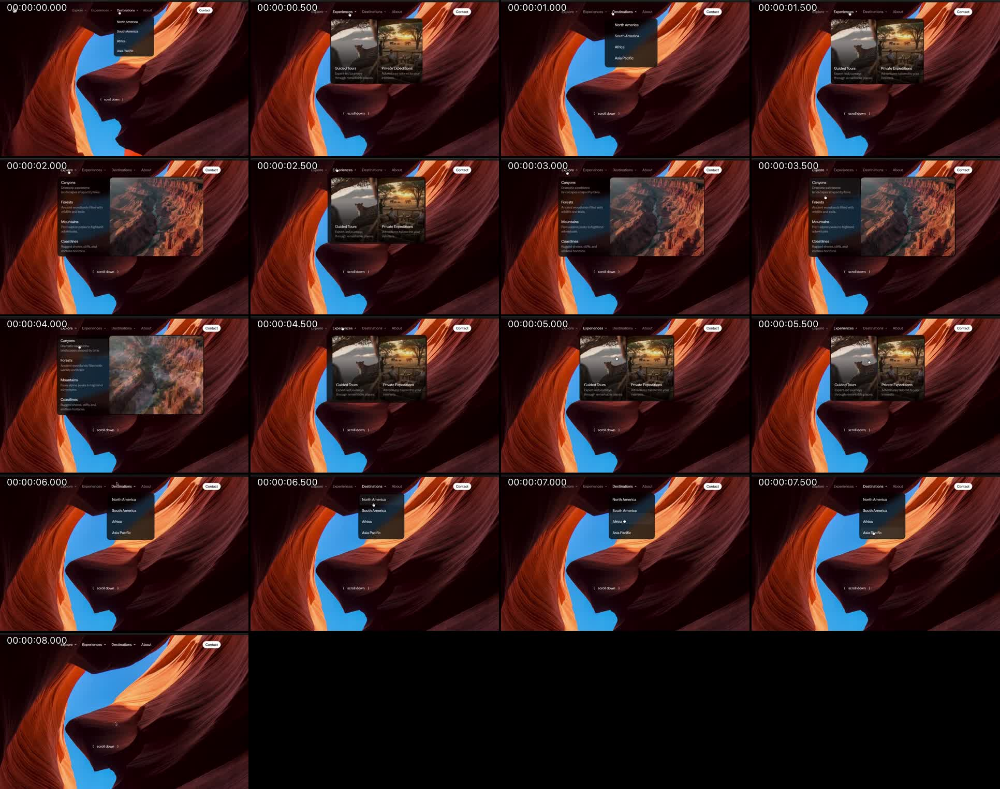
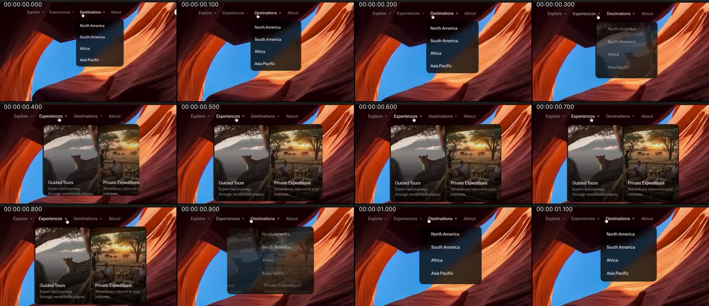

**O que tem:**
- **Hero em tela cheia:** foto do cânion Antelope vista de baixo. As curvas do arenito em diagonal levam ao centro, com o céu azul complementar.
- **Navegação mínima:** 4 itens de texto com chevron + "Contact" em pílula branca. "( scroll down )" entre parênteses no meio, um microdetalhe tipográfico.
- **Dropdown com um único container que se transforma:** o mesmo painel de vidro escuro **muda de tamanho e de lugar** entre os menus:
  - *Destinations:* lista de 4 itens, estreito
  - *Experiences:* 2 cards com foto, mais largo
  - *Explore:* lista com descrição + imagem grande de prévia
  - Entre 0,2 e 0,4 s o painel muda de forma enquanto o conteúdo antigo some (~100 ms) e o novo entra. Em 0,9 s dá para ver os dois conteúdos sobrepostos: é um **crossfade dentro do morph**.
  - O morph inteiro leva **~250–300 ms**.
- **Vidro tingido pela foto:** o painel não é cinza, pega o vermelho do cânion (`backdrop-filter` + véu escuro).
- **Mega menu (Explore):** passar o mouse num item troca a imagem com **dissolve e blur** (quadro de 4,0 s).

**Como construir:**
- React: `motion.div layout` no painel + `AnimatePresence mode="popLayout"` para o conteúdo (receita 17.5).
- Sem React: o **NavigationMenu do Radix** expõe o tamanho do viewport em variáveis CSS para animar. Ou GSAP Flip.
- Vidro: `background: rgb(18 8 6 / .55); backdrop-filter: blur(20px) saturate(1.4); border: 1px solid rgb(255 255 255 / .08); border-radius: 14px`.
- Refinamento opcional: o conteúdo novo entra 16–24 px **do lado para onde o painel está indo**.

**O que roubar:** um container, vários conteúdos; o vidro pega a cor da foto; o hover troca a prévia com dissolve.

### Vídeo 2: prédio + pílula que vira painel (`ssstwitter.com_1795261047046.mp4`)

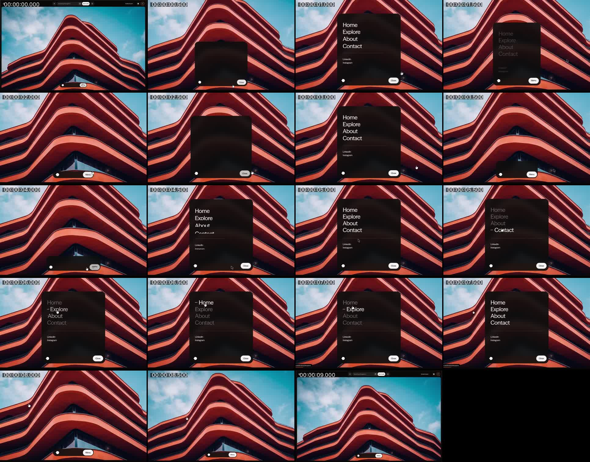
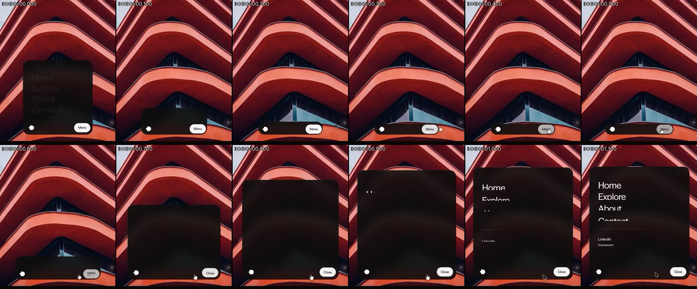

**O que tem:**
- **Hero em tela cheia:** varandas vermelhas curvas repetidas (ritmo) contra o céu, mais uma complementar natural.
- **Dock flutuante embaixo:** barra-pílula escura com o logo (bolinha) à esquerda e "Menu" em pílula branca à direita. É padrão de celular (zona do polegar) levado para o desktop, primo da Dynamic Island.
- **Clique:**
  1. O botão mostra o estado **apertado** (fica cinza): antecipação.
  2. O container **cresce da pílula para um card grande**, ancorado embaixo, mantendo o raio. Leva ~400–500 ms em ease-out (0,6 → 1,0 s no zoom).
  3. **Depois** que o container está quase aberto, os links entram **linha a linha com máscara**: as letras aparecem cortadas no quadro de 0,9 s, em cascata de ~60–80 ms.
  4. As redes sociais entram por último. "Menu" vira "Close".
- **Hover:** o link ganha um **tracinho** ("– Explore") e os irmãos apagam para ~40%. É foco por subtração.
- **Fechar:** o conteúdo some primeiro e o container encolhe de volta para a pílula. É mais rápido que abrir (~300 ms).
- **Superfície do painel:** quase preta `#0f0b0f` com um gradiente quente sutil, tirado da foto.

**Como construir:** GSAP Flip com `props: "borderRadius"` + SplitText `mask: "lines"` (receita 17.6), ou Motion `layout`. O tracinho é um `::before` com largura de 0 → 0,6 em.

**O que roubar:** continuidade espacial total (o menu **é** a pílula), cascata depois do container e o tracinho no hover.

### Vídeo 3: busto em dithering que segue o cursor (`ssstwitter.com_1795261125282.mp4`)

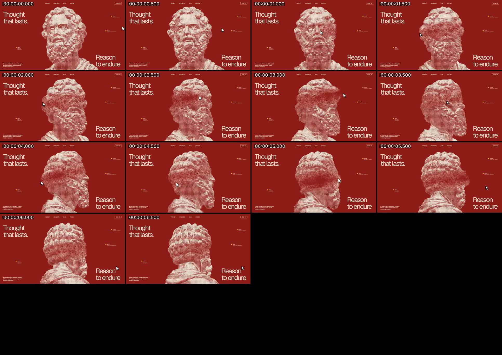
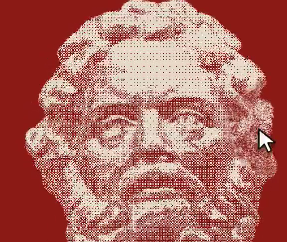

**O que tem:**
- **Fundo vermelho romano `#8b1a15`** e busto clássico em **dither ordenado de 2 tintas** (creme `#ffe3dd`).
- **Tipografia nos cantos opostos:** "Thought that lasts." em cima à esquerda e "Reason to endure" embaixo à direita, com o busto como eixo diagonal.
- **Detalhes:** nav pequena em mono, "SIGN IN" com contorno e rótulos minúsculos em mono com **quadradinhos laranja** `#feaf3c` (parecem pontos de dado).
- **Interação:** movendo o cursor na horizontal, o busto **gira de frente para perfil** (0 → 5 s). Em volta do cursor o padrão do dither **se embaralha**, deixa um rastro e volta ao normal.

**Como construir:**
- **Rota completa:** Three.js + GLTF do busto (scans de museu em domínio público) + pós-processamento de dither ordenado com 2 tintas.
  - Rotação com lerp: `rot += (alvo - rot) * 0.08`, alvo = `mouseX * 0.6`.
  - Rastro: renderize o caminho do mouse num FBO pequeno que vai apagando (*ping-pong*) e use-o para deslocar UV ou o limiar **antes** do dither.
- **Rota leve:** pré-renderize ~48 quadros da rotação, aplique o dither **offline** (Pillow/pixel-art-studio) e troque o quadro pelo X do cursor num `<canvas>`. Roda a 60 qps até em Celeron.
- O rastro de pixels já existe como receita local: `~/.parede-da-ia/library/motion/pixel-trail.js`.

**O que roubar:** o dither "traz" um objeto clássico para a paleta da marca; tipografia ancorada nos cantos; metadados em mono.

---

## 17. Receitas prontas (código)

### 17.1 Tokens de tema (claro e escuro num token só)

```css
:root {
  color-scheme: light dark;
  --bg:        light-dark(oklch(.975 .006 85), oklch(.145 .006 260));
  --surface-1: light-dark(oklch(.99 .006 85),  oklch(.175 .006 260));
  --surface-2: light-dark(oklch(1 0 0),        oklch(.205 .006 260));
  --border:    light-dark(oklch(.89 .006 85),  oklch(.295 .006 260));
  --text-1:    light-dark(oklch(.22 .006 85),  oklch(.95 .006 260));
  --text-2:    light-dark(oklch(.45 .006 85),  oklch(.77 .006 260));
  --text-3:    light-dark(oklch(.52 .006 85),  oklch(.62 .006 260));
  --accent:    light-dark(oklch(.55 .22 264),  oklch(.72 .15 264));   /* dessaturado no escuro */
  --on-accent: light-dark(oklch(1 0 0),        oklch(.145 .006 260));
  --hairline:  light-dark(rgb(0 0 0 / .08),    rgb(255 255 255 / .08));
  --highlight: light-dark(rgb(255 255 255 / .9), rgb(255 255 255 / .06));
}
:root[data-theme="light"] { color-scheme: light; }
:root[data-theme="dark"]  { color-scheme: dark; }

body { background: var(--bg); color: var(--text-1); }
.card {
  background: var(--surface-1);
  border: 1px solid var(--hairline);
  box-shadow:
    inset 0 1px 0 var(--highlight),            /* luz de cima */
    0 1px 2px rgb(0 0 0 / .06),
    0 12px 32px -12px rgb(0 0 0 / .18);        /* no escuro quase some, e tudo bem */
}
```

```html
<!-- no <head>, antes de qualquer CSS: evita o flash -->
<script>try{var t=localStorage.getItem('theme');if(t)document.documentElement.dataset.theme=t}catch(e){}</script>
```

### 17.2 Shell moniscalling

Ver a seção 11.

### 17.3 Hero que encolhe em moldura ao rolar (a vinhetinha moniscalling)

```html
<section class="hero"><div class="hero__frame"></div></section>
```

```css
html, body { background: #000; }
.hero { height: 100svh; }
.hero__frame { height: 100%; clip-path: inset(0 round 0); overflow: hidden; }
.hero__frame img { width: 100%; height: 100%; object-fit: cover; }

/* sem JS, onde houver suporte */
@supports (animation-timeline: scroll()) {
  @media (prefers-reduced-motion: no-preference) {
    .hero__frame     { animation: frame linear both; animation-timeline: scroll(root); animation-range: 0 70vh; }
    .hero__frame img { animation: push  linear both; animation-timeline: scroll(root); animation-range: 0 70vh; }
    @keyframes frame { to { clip-path: inset(12px round 28px); } }   /* t = 12, R = 28 */
    @keyframes push  { to { scale: 1.08; } }                          /* a imagem "afunda" */
  }
}
```

```js
// versão GSAP (Firefox incluso, com pin)
gsap.registerPlugin(ScrollTrigger);
gsap.matchMedia().add('(prefers-reduced-motion: no-preference)', () => {
  gsap.timeline({ scrollTrigger: { trigger: '.hero', start: 'top top', end: '+=70%', scrub: true, pin: true } })
    .to('.hero__frame', { clipPath: 'inset(12px round 28px)', ease: 'none' })
    .to('.hero__frame img', { scale: 1.08, ease: 'none' }, '<');
});
```

### 17.4 Cortina (a próxima seção sobe por cima)

```css
.hero    { position: sticky; top: 0; height: 100svh; }
.content { position: relative; z-index: 1; background: var(--bg);
           border-radius: 32px 32px 0 0; box-shadow: 0 -24px 60px rgb(0 0 0 / .35); }
@supports (animation-timeline: view()) {
  .hero { animation: dim linear both; animation-timeline: view(); animation-range: exit 0% exit 100%; }
  @keyframes dim { to { filter: brightness(.55); scale: .96; } }
}
```

### 17.5 Dropdown que se transforma (Motion, React): vídeo 1

```jsx
import { motion, AnimatePresence } from 'motion/react';

export function MegaNav({ items }) {            // items: [{ id, label, panel: <JSX/> }]
  const [active, setActive] = useState(null);
  const [dir, setDir] = useState(0);
  const open = (i) => { setDir(active === null ? 0 : Math.sign(i - active)); setActive(i); };
  return (
    <nav onPointerLeave={() => setActive(null)}>
      {items.map((it, i) => <button key={it.id} onPointerEnter={() => open(i)}>{it.label}</button>)}
      <AnimatePresence>
        {active !== null && (
          <motion.div layout className="nav-panel" style={{ borderRadius: 14 }}
            initial={{ opacity: 0, y: -6 }} animate={{ opacity: 1, y: 0 }} exit={{ opacity: 0, y: -6 }}
            transition={{ type: 'spring', bounce: 0, duration: 0.3 }}>
            <AnimatePresence mode="popLayout" initial={false} custom={dir}>
              <motion.div key={active}
                initial={{ opacity: 0, x: dir * 20 }} animate={{ opacity: 1, x: 0 }}
                exit={{ opacity: 0, x: dir * -20 }} transition={{ duration: 0.18 }}>
                {items[active].panel}
              </motion.div>
            </AnimatePresence>
          </motion.div>
        )}
      </AnimatePresence>
    </nav>
  );
}
```

```css
.nav-panel { position: absolute; top: 56px; left: var(--x, 50%); padding: 12px;
  background: rgb(18 8 6 / .55); backdrop-filter: blur(20px) saturate(1.4);
  border: 1px solid rgb(255 255 255 / .08); }
```

### 17.6 Pílula → painel (GSAP Flip + SplitText): vídeo 2

```js
gsap.registerPlugin(Flip, SplitText);
const dock = document.querySelector('.dock');
const btn  = dock.querySelector('.dock__btn');
const split = SplitText.create('.dock__links a', { type: 'lines', mask: 'lines' });

btn.addEventListener('click', () => {
  const opening = !dock.classList.contains('is-open');
  const state = Flip.getState(dock, { props: 'borderRadius' });
  dock.classList.toggle('is-open', opening);          // o CSS define o tamanho do painel
  btn.textContent = opening ? 'Close' : 'Menu';
  if (opening) {
    Flip.from(state, { duration: 0.5, ease: 'expo.out' });
    gsap.from(split.lines, { yPercent: 110, duration: 0.6, ease: 'expo.out', stagger: 0.06, delay: 0.18 });
  } else {
    gsap.to(split.lines, { autoAlpha: 0, duration: 0.12 });
    Flip.from(state, { duration: 0.32, ease: 'power3.inOut', onComplete: () => gsap.set(split.lines, { autoAlpha: 1 }) });
  }
});
```

```css
.dock__btn:active { scale: .96; background: #d4d4d4; }          /* antecipação */
.dock__links a::before { content: '–'; display: inline-block; width: 0; overflow: hidden;
  transition: width var(--dur-2) var(--ease-out); }
.dock__links a:hover::before { width: .6em; }
.dock__links:hover a:not(:hover) { opacity: .4; }                /* foco por subtração */
```

### 17.7 Halftone em CSS puro, com 2 tintas (vídeo 3 sem WebGL)

```html
<div class="duo"><div class="halftone" role="img" aria-label="Busto clássico"></div></div>
```

```css
.halftone {
  --cell: 7px;
  aspect-ratio: 4 / 5;
  background:
    radial-gradient(closest-side, #777, #fff) 0 0 / var(--cell) var(--cell),  /* a trama */
    url(busto.jpg) center / cover;                                            /* a imagem */
  background-blend-mode: multiply;
  filter: grayscale(1) contrast(16);      /* empurra tudo para preto ou branco = pontos */
}
/* colorir: preto → vermelho romano, branco → creme */
.duo { position: relative; isolation: isolate; }
.duo::before, .duo::after { content: ''; position: absolute; inset: 0; pointer-events: none; }
.duo::before { background: #8b1a15; mix-blend-mode: lighten;  z-index: 1; }
.duo::after  { background: #ffe3dd; mix-blend-mode: multiply; z-index: 2; }
```

> Receita adaptada de Frontend Masters (*Pure CSS Halftone Effect in 3 Declarations*) e de Michelle Barker (CSS-irl). **Ajuste `--cell` e o `contrast()` na sua imagem**: cada foto pede um valor.

### 17.8 Dither ordenado (Bayer 8×8) em shader: 2 tintas + dissolver

```glsl
precision highp float;
uniform sampler2D uImage;
uniform vec2  uResolution;   // tamanho do canvas em px
uniform float uPx;           // tamanho do "pixel" do dither: inteiro × DPR
uniform vec3  uInkA;         // fundo  (ex.: #8b1a15 → vec3(.545,.102,.082))
uniform vec3  uInkB;         // tinta  (ex.: #ffe3dd)
uniform float uThreshold;    // 0 = normal; anime 0→1 para dissolver a imagem em pixels

float bayer2(vec2 a) { a = floor(a); return fract(a.x / 2.0 + a.y * a.y * 0.75); }
#define bayer4(a) (bayer2(0.5 * (a)) * 0.25 + bayer2(a))
#define bayer8(a) (bayer4(0.5 * (a)) * 0.25 + bayer2(a))

void main() {
  vec2 cell = floor(gl_FragCoord.xy / uPx);
  vec2 uv   = (cell + 0.5) * uPx / uResolution;      // amostra no centro da célula
  uv.y = 1.0 - uv.y;                                 // gl_FragCoord tem origem embaixo
  vec3 c = texture2D(uImage, uv).rgb;
  c = pow(c, vec3(2.2));                             // sRGB → linear (aviso do Surma)
  float l  = dot(c, vec3(0.2126, 0.7152, 0.0722));
  float on = step(bayer8(cell) + uThreshold, l);
  gl_FragColor = vec4(mix(uInkA, uInkB, on), 1.0);
}
```

**ASCII no mesmo esquema:** troque o limiar por um índice de glifo num atlas (`" .:-=+*#%@"`):

```glsl
uniform sampler2D uGlyphs; uniform float uN; uniform vec2 uCell;   // ex.: célula de 8×12 px
void main() {
  vec2 cell = floor(gl_FragCoord.xy / uCell), f = fract(gl_FragCoord.xy / uCell);
  vec2 uv = (cell + 0.5) * uCell / uResolution; uv.y = 1.0 - uv.y;
  vec3 c = texture2D(uImage, uv).rgb;
  float g = floor(dot(c, vec3(.2126, .7152, .0722)) * (uN - 1.0) + 0.5);
  float m = texture2D(uGlyphs, vec2((g + f.x) / uN, f.y)).r;
  gl_FragColor = vec4(c * m, 1.0);     // ASCII colorido (refs 06/07); para mono use mix(uInkA, uInkB, m)
}
```

### 17.9 Grão (overlay leve, sem imagem externa)

```css
.grain { position: relative; }
.grain::after {
  content: ''; position: absolute; inset: 0; pointer-events: none;
  opacity: .10; mix-blend-mode: overlay;
  background-image: url("data:image/svg+xml,%3Csvg xmlns='http://www.w3.org/2000/svg' width='160' height='160'%3E%3Cfilter id='n'%3E%3CfeTurbulence type='fractalNoise' baseFrequency='.9' numOctaves='2' stitchTiles='stitch'/%3E%3C/filter%3E%3Crect width='100%25' height='100%25' filter='url(%23n)'/%3E%3C/svg%3E");
}
```

### 17.10 Gradiente com crista de luz (as "ondas")

```css
@property --x { syntax: '<percentage>'; inherits: false; initial-value: 30%; }
@property --sweep { syntax: '<percentage>'; inherits: false; initial-value: -60%; }

.field { position: relative; overflow: hidden; isolation: isolate; background: #050816; }
.field::before {                       /* massa de cor */
  content: ''; position: absolute; inset: -20%;
  background:
    radial-gradient(40% 35% at var(--x) 40% in oklch, #3a5bff, transparent 70%),
    radial-gradient(35% 30% at 70% 65% in oklch, #ff6a1a, transparent 70%),
    radial-gradient(50% 40% at 40% 85% in oklch, #1b2a63, transparent 70%);
  filter: blur(70px);
  animation: drift 22s ease-in-out infinite alternate;
}
.field::after {                        /* a crista: faixa estreita e clara que passa */
  content: ''; position: absolute; inset: -30%;
  background: linear-gradient(115deg, transparent 44%, rgb(255 240 220 / .6) 50%, transparent 56%)
              var(--sweep) 0 / 200% 100% no-repeat;
  filter: blur(28px); mix-blend-mode: screen;   /* testado no Chrome: .45/36px some; .75/22px vira faixa dura */
  animation: sweep 14s var(--ease-in-out) infinite;
}
@keyframes drift { to { --x: 62%; transform: rotate(8deg) scale(1.06); } }
@keyframes sweep { to { --sweep: 160%; } }
@media (prefers-reduced-motion: reduce) { .field::before, .field::after { animation: none; } }
/* + .grain por cima */
```

### 17.11 GSAP: matchMedia, Lenis e cursor

```js
gsap.registerPlugin(ScrollTrigger, SplitText);
gsap.defaults({ ease: 'expo.out', duration: 0.9 });

const mm = gsap.matchMedia();
mm.add({ desktop: '(min-width: 800px)', reduce: '(prefers-reduced-motion: reduce)' }, (ctx) => {
  const { desktop, reduce } = ctx.conditions;
  if (reduce) { gsap.set('.reveal', { autoAlpha: 1 }); return; }
  gsap.utils.toArray('.reveal').forEach((el) =>            // um trigger por elemento (erro nº 3)
    gsap.from(el, { y: desktop ? 40 : 20, autoAlpha: 0, scrollTrigger: { trigger: el, start: 'top 85%' } }));
});

// Lenis + ScrollTrigger
const lenis = new Lenis();
lenis.on('scroll', ScrollTrigger.update);
gsap.ticker.add((t) => lenis.raf(t * 1000));
gsap.ticker.lagSmoothing(0);

// cursor que segue sem criar tween por evento
const xTo = gsap.quickTo('.cursor', 'x', { duration: 0.4, ease: 'power3' });
const yTo = gsap.quickTo('.cursor', 'y', { duration: 0.4, ease: 'power3' });
addEventListener('pointermove', (e) => { xTo(e.clientX); yTo(e.clientY); });
```

### 17.12 Troca de tema com círculo (View Transitions)

```js
function setTheme(next) { document.documentElement.dataset.theme = next; try { localStorage.setItem('theme', next); } catch (e) {} }
function toggleTheme(e) {
  const next = document.documentElement.dataset.theme === 'dark' ? 'light' : 'dark';
  if (!document.startViewTransition || matchMedia('(prefers-reduced-motion: reduce)').matches) return setTheme(next);
  const x = e.clientX, y = e.clientY;
  const r = Math.hypot(Math.max(x, innerWidth - x), Math.max(y, innerHeight - y));
  document.startViewTransition(() => setTheme(next)).ready.then(() =>
    document.documentElement.animate(
      { clipPath: [`circle(0 at ${x}px ${y}px)`, `circle(${r}px at ${x}px ${y}px)`] },
      { duration: 500, easing: 'cubic-bezier(.22,1,.36,1)', pseudoElement: '::view-transition-new(root)' }));
}
```

```css
::view-transition-old(root), ::view-transition-new(root) { animation: none; mix-blend-mode: normal; }
```

---

## 18. Checklist antes de publicar

**Direção de arte**
- [ ] Um ponto focal por tela; o título da hero tem ≤ 8 palavras
- [ ] A interface funciona em preto e branco (teste do Albers)
- [ ] 1 display + 1 texto + 1 mono; 1 campo de cor + 1 acento; proporção declarada
- [ ] Raios derivados (moniscalling): nenhum raio "solto"
- [ ] Um tratamento de imagem aplicado a todas as imagens
- [ ] Passou na tabela de slop da seção 4

**Cor e tema**
- [ ] Gradientes em OKLCH, com grão e sem banding (veja a captura @2x)
- [ ] Contraste AA em todo texto, **no pior ponto e no pior quadro**
- [ ] Os dois temas testados; escuro sem `#fff` em texto grande e sem `#000` em superfície de leitura
- [ ] Sem flash de tema no load

**Movimento**
- [ ] Cada animação tem propósito escrito (orientar, retorno, continuidade, personalidade)
- [ ] Um dialeto só de easing e duração; UI < 300 ms; seção ≤ 1,2 s
- [ ] Tudo interrompível; nada anima em ação de teclado
- [ ] `prefers-reduced-motion` com versão alternativa (não "nada")
- [ ] Só `transform`, `opacity` e `clip-path` animados; sem jank no scroll

**Performance**
- [ ] LCP ≤ 2,5 s; imagem da hero ≤ 200 KB AVIF; `fetchpriority="high"`
- [ ] Shaders a 0,5–0,75× do DPR, pausados fora da tela, com fallback estático
- [ ] WebGL e shaders iniciam depois do load

**Acessibilidade**
- [ ] Foco visível em tudo; navegação por teclado no menu morph e no dock
- [ ] Arte em dithering ou ASCII tem `alt` ou `aria-hidden`; SplitText com `aria-label` (já vem na 3.13)
- [ ] `prefers-contrast` e "reduzir transparência" respeitados

**Ferramentas locais** (parede-da-ia): `web-audit` ≥ 85 em desktop, tablet e mobile · `web-interactions` sem foco invisível · `web-motion` confirma reduced motion · `web-record-frames` para ler o scroll.

---

## 19. Fontes

**Apple e designers**
- Steve Jobs, "The Guts of a New Machine", NYT Magazine (2003): https://www.nytimes.com/2003/11/30/magazine/the-guts-of-a-new-machine.html · contexto: https://designobserver.com/the-guts-of-a-new-machine/
- Jony Ive sobre simplicidade: https://www.techradar.com/news/computing/apple/ive-on-apple-s-quest-for-simplicity-1081643 · https://tobiasahlin.com/blog/simplicity-is-not-the-absence-of-clutter
- Jony Ive × Patrick Collison, Stripe Sessions 2025: https://stripe.com/sessions/2025/a-conversation-with-sir-jony-ive · notas: https://blog.jim-nielsen.com/2025/notes-from-interview-with-jony-ive/
- Alan Dye, "99% of the work…": https://www.techradar.com/phones/ios/99-percent-of-the-work-doesnt-make-it-out-apples-vp-of-human-interface-design-on-how-liquid-glass-hits-the-high-bar
- Apple, press release do Liquid Glass: https://www.apple.com/newsroom/2025/06/apple-introduces-a-delightful-and-elegant-new-software-design/
- WWDC18 803, Designing Fluid Interfaces: https://developer.apple.com/videos/play/wwdc2018/803/
- WWDC25 356, Get to know the new design system: https://developer.apple.com/videos/play/wwdc2025/356/
- ConcentricRectangle: https://developer.apple.com/documentation/swiftui/concentricrectangle · https://nilcoalescing.com/blog/ConcentricRectangleInSwiftUI
- HIG, Dark Mode: https://developer.apple.com/design/human-interface-guidelines/dark-mode
- Dieter Rams, Good design (Vitsœ): https://www.vitsoe.com/gb/about/good-design

**Cor e temas**
- Evil Martians, OKLCH in CSS: https://evilmartians.com/chronicles/oklch-in-css-why-quit-rgb-hsl
- Linear, How we redesigned the Linear UI: https://linear.app/now/how-we-redesigned-the-linear-ui
- Radix, Understanding the scale: https://www.radix-ui.com/colors/docs/palette-composition/understanding-the-scale
- Material, Dark theme: https://m2.material.io/design/color/dark-theme
- APCA (Myndex): https://github.com/Myndex/apca-introduction · status do WCAG 3 em abril de 2026 (Adrian Roselli): https://adrianroselli.com/2026/04/wcag3-contrast-as-of-april-2026.html
- Paletas acromáticas: https://octet.design/colors/compositions/achromatic

**Geometria (moniscalling)**
- Cloud Four, The math behind nesting rounded corners: https://cloudfour.com/thinks/the-math-behind-nesting-rounded-corners/
- Chrome, corner-shape no Blink: https://developer.chrome.com/blog/implementing-corner-shape · MDN: https://developer.mozilla.org/docs/Web/CSS/Reference/Properties/corner-shape · Smashing (2026): https://www.smashingmagazine.com/2026/03/beyond-border-radius-css-corner-shape-property-ui/
- Mozilla, nota sobre raios concêntricos (redesign Nova): https://bugzilla.mozilla.org/show_bug.cgi?id=2053333

**Dithering, halftone e ASCII**
- Surma, Ditherpunk: https://surma.dev/things/ditherpunk/
- Maxime Heckel, The Art of Dithering and Retro Shading for the Web: https://blog.maximeheckel.com/posts/the-art-of-dithering-and-retro-shading-web
- Codrops, Building a Real-Time Dithering Shader (2025): https://tympanus.net/codrops/2025/06/04/building-a-real-time-dithering-shader/
- Codrops, Animating 160,000 Cubes… Dithering (2026): https://tympanus.net/codrops/2026/04/01/animating-160000-cubes-in-three-js-to-visualize-dithering/
- Codrops, Efecto, ASCII + dithering em WebGL (2026): https://tympanus.net/codrops/2026/01/04/efecto-building-real-time-ascii-and-dithering-effects-with-webgl-shaders
- Codrops, Creating an ASCII Shader Using OGL: https://tympanus.net/codrops/2024/11/13/creating-an-ascii-shader-using-ogl/
- Emil Widlund, The secrets behind rendering anything as ASCII: https://polar.sh/emilwidlund/posts/the-secrets-behind-rendering-anything-as-ascii
- Paper Shaders: https://shaders.paper.design/dithering
- ascii.rest (make): https://ascii.rest/make · https://github.com/bas3line/ascii
- lettercrap: https://github.com/lettercrap/lettercrap · p5.asciify: https://www.npmjs.com/package/p5.asciify
- Halftone em CSS: https://frontendmasters.com/blog/pure-css-halftone-effect-in-3-declarations/ · https://css-irl.info/css-halftone-patterns/
- Tanner Helland, 11 algoritmos de dithering: https://tannerhelland.com/2012/12/28/dithering-eleven-algorithms-source-code.html

**Gradientes**
- Bram.us, Stripe Website Gradient Effect: https://www.bram.us/2021/10/13/how-to-create-the-stripe-website-gradient-effect
- Grainy gradients (Ana Tudor): https://frontendmasters.com/blog/grainy-gradients/ · gerador: https://fffuel.co/gggrain/

**Animação**
- GSAP 3.13 (gratuito, SplitText): https://gsap.com/blog/3-13/ · Webflow: https://webflow.com/blog/gsap-becomes-free · https://webflow.com/blog/gsap-splittext-rewrite
- GSAP, ScrollTrigger tips & mistakes: https://gsap.com/resources/st-mistakes/ · GSAP & React: https://gsap.com/resources/React/ · Flip: https://gsap.com/docs/v3/Plugins/Flip
- Motion, independência: https://motion.dev/blog/framer-motion-is-now-independent-introducing-motion · um ano depois: https://motion.dev/blog/motion-independence-one-year-in-review
- Emil Kowalski, Great Animations: https://emilkowal.ski/ui/great-animations
- Rauno Freiberg, Invisible Details of Interaction Design: https://rauno.me/craft/interaction-design
- web.dev, The basics of easing: https://web.dev/articles/the-basics-of-easing
- View Transitions Baseline: https://web.dev/blog/same-document-view-transitions-are-now-baseline-newly-available · https://developer.chrome.com/blog/view-transitions-in-2025
- WebKit, Scroll-driven animations: https://www.webkit.org/blog/17101/a-guide-to-scroll-driven-animations-with-just-css/ · Safari 26: https://webkit.org/blog/17333/webkit-features-in-safari-26-0/

**Landing pages e tendências**
- Awwwards Annual Awards, vencedores: https://www.awwwards.com/annual-awards/winners · Lando Norris: https://www.awwwards.com/sites/lando-norris · OFF+BRAND na Codrops: https://tympanus.net/codrops/2026/08/17/creativity-at-enterprise-scale-without-compromise-the-offbrand-story/ · abeto: https://www.awwwards.com/abeto/
- Tendências 2026: https://webflow.com/blog/web-design-trends-2026 · https://www.fastcompany.com/91462141/the-biggest-brand-trends-coming-in-2026 · https://kota.co.uk/blog/branding-inspiration-brand-design-trends-for-2026 · https://www.vistaprint.com/hub/graphic-design-trends
- Slop de IA no design: https://capitalandcompute.net/blog/fix-ai-slop-design/ · https://world.hey.com/kostac/spot-the-slop-a-ui-designer-s-guide-to-fixing-ai-defaults-4c448c9c
- Landing pages 2026: https://www.involve.me/blog/landing-page-trends · https://empire-ui.com/blog/landing-page-design-patterns

**Módulos locais aplicados** (`~/.parede-da-ia/prompts/`): `aesthetics/atmospheric-gradient.md` · `aesthetics/blur-library.md` · `knowledge-base/16` (cor) · `17` (shaders) · `12` (Illusion of Life) · `13` (Interface Animation). Receitas: `~/.parede-da-ia/library/` (`gradients/blur-library.css`, `gradients/mesh-field.glsl`, `motion/pixel-trail.js`, `motion/magnetic.js`, `motion/hover-font.js`).

---

### Notas de verificação

- As cores das paletas foram **medidas nos seus arquivos** (média por blocos + amostras pontuais) e os contrastes **calculados** pela fórmula do WCAG 2.
- A geometria do moniscalling foi **medida em pixel** na ref. 05.
- Os tempos dos vídeos são **estimativas** feitas a partir de quadros a 10 qps (±50 ms).
- Não consegui ler o artigo *Efecto* da Codrops (bloqueado para leitura automática) nem o texto completo do HIG de Dark Mode (página em JS). Os dois estão citados como leitura recomendada; as regras de tema escuro vêm do Material, da WWDC e da prática.
- A citação do Jobs à Fortune (2000) é clássica, mas não foi reverificada aqui. As do Ive em Stripe Sessions vêm da transcrição de Jim Nielsen.
- As receitas 17.7 (halftone de 2 tintas), 17.10 (crista de luz) e o shell moniscalling foram **renderizadas no Chrome headless**. O resultado está em `PesquisadeCampo/diagramas/teste-receitas-chrome.png`. Elas são pontos de partida: ajuste `--cell`, o `contrast()` e a opacidade da crista na sua imagem. As receitas de GSAP, Motion e shader não foram executadas aqui.

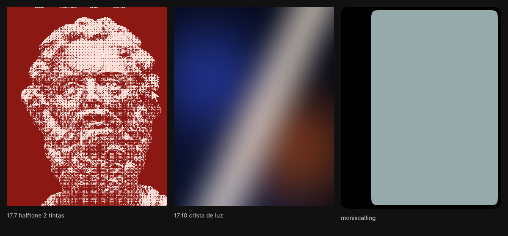
